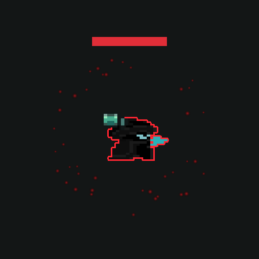

# 공격 준비 파티클

기믹상 명확한 준비 대기가 있는 Enemy18과 Enemy20의 자식 `AttackPreparationModule`에 연결했다. 두 적은 `Assets/_Prefabs/Enemies/Effects/EnemyAttackPreparationModule.prefab`을 중첩 사용하므로 공통 기본값을 한 곳에서 변경하거나 적마다 Override할 수 있다. Enemy17·19·21·22에서는 이 모듈의 연결을 제거했다.

입자가 적의 주변에서 생성되어 점점 빨라지며 중심으로 모인다. Unity 기본 `Default-Particle`의 부드러운 알파 텍스처를 전용 Unlit 머티리얼에서 사용한다. 텍스처의 알파는 중심 약 0.97, 중간 약 0.33, 가장자리 0으로 확인했다.

## 조정

| 인스펙터 항목 | 기본값 | 의미 |
| --- | --- | --- |
| Particles Enabled | 켜짐 | 파티클 사용 여부. 컴포넌트를 꺼도 표시와 추가 대기가 해제된다 |
| Gather Time | 0.25초 | 입자가 모이는 시간. 기존 준비 시간보다 길면 다 모일 때까지 발동을 기다린다 |
| Particle Count | 40개 | 한 번에 생성할 개수. 1~128개 |
| Particle Color | RGBA (0.65, 0.08, 0.10, 0.95) | 짙은 붉은색. 알파도 조정할 수 있다 |
| Spawn Radius | 0.8~1.25 | 입자가 출발할 최소·최대 반경. 월드 유닛 |
| Particle Size | 0.07~0.15 | 입자의 최소·최대 크기. 월드 유닛 |
| Center Override | 비어 있음 | 모일 지점을 직접 지정. 비우면 적 루트 콜라이더의 중심을 따라간다 |
| Center Offset | (0, 0) | 중심에서 더할 월드 좌표 보정 |
| Sorting Source | 비어 있음 | 기준 SpriteRenderer. 비우면 초기화 시 적의 첫 SpriteRenderer를 사용한다 |
| Sorting Order Offset | 2 | 기준 그림보다 앞뒤로 그릴 순서 차이 |
| Particle Prefab | AttackPreparationGather | 부드러운 입자 렌더링용 공통 파티클 프리팹 |

기존 준비가 0.6초이고 Gather Time이 0.25초이면 처음 0.35초는 기존 자세를 유지하고 마지막 0.25초 동안 입자가 모인 뒤 공격한다. Gather Time을 0.8초로 바꾸면 준비 시작부터 0.8초 동안 모인 뒤 공격한다. 따라서 모이는 시간을 짧게 해도 기존 공격 준비 시간 자체가 단축되지는 않는다. 기존 준비 시간은 스킬의 Attack Delay와 Post Blink Delay로 조정한다.

게임 코드에서는 `module.ParticlesEnabled = false;`로 끌 수 있다. 준비 중 끄면 재생 중인 입자를 즉시 반환한다. 다시 켰을 때는 다음 공격 준비부터 적용된다. 피격으로 공격이 취소되거나 타깃이 해제되거나 적이 사망·비활성화되면 입자도 즉시 정리한다.

## 재사용과 풀링

`AttackPreparationGather.prefab`을 `LeanPool.Spawn`으로 가져와 재생하고, 발동·취소 시 `LeanPool.Despawn`으로 반환한다. 적마다 별도 ParticleSystem을 계속 생성하지 않으며 같은 풀의 비활성 인스턴스를 재사용한다. 별도의 씬 오브젝트나 PoolManager 연결은 필요하지 않다.

모듈을 제거하거나 비활성화하면 기존 스킬의 준비와 발동이 그대로 동작한다. 파티클의 시간 제어는 이 모듈에 두고, 공용 공격 스킬에는 준비 시작·발동 가능 확인·정리 호출만 추가했다. 범위 경고나 저지 불가의 기존 처리는 유지한다.

## 직접 테스트

1. `Assets/_Scenes/Test/EnemyTestScene.unity`에서 Enemy18 또는 Enemy20을 활성화하고 공격을 유도한다. 준비의 마지막 구간에 짙은 붉은색 입자 40개가 주변에서 중심으로 모인 뒤 공격해야 한다. Enemy17·19·21·22의 준비에는 이 입자가 나타나지 않아야 한다.
2. 해당 적 자식 `AttackPreparationModule`의 Gather Time을 0.8로 늘리고 Particle Count를 64로 바꾼다. 입자가 모이기 전에 공격하지 않고 약 0.8초 뒤 공격하는지 확인한다.
3. Particles Enabled를 끄면 입자 없이 기존 준비 시간대로 공격해야 한다. 준비 중에도 체크를 꺼서 즉시 사라지는지 확인할 수 있다.
4. 준비 중 처치하거나 Particles Enabled를 끈다. 준비의 입자가 남지 않아야 한다. 두 적은 준비 중 저지 불가이므로 일반 피격에는 준비와 입자가 유지된다. 반복 공격 시 Hierarchy의 `LeanPool (AttackPreparationGather)` 아래 인스턴스가 반환되고 다음 공격에 재사용되는지 확인한다.

`EnemyTestScene` 실행 검증에서 Enemy18·20에 짙은 붉은색 입자 40개가 재생되고 기존 준비 시간대로 발동한 뒤 풀로 반환되는 것을 확인했다. 프리팹 검사로 나머지 네 적에서 모듈 연결이 제거된 것도 확인했다. 컴파일 오류와 끊어진 프리팹 참조는 없었다. 검증 후 원래 열려 있던 씬으로 복귀했으며 씬 파일은 저장하지 않았다.

## 사용한 문법과 이유

- `[SerializeField]`, `[Min]`, `[Range]`로 설정을 인스펙터에 노출하고 시간과 개수의 입력 범위를 정했다. 새 스탯이나 공용 시스템을 추가하지 않고 적별로 조정할 수 있다.
- `ParticleSystem.EmitParams`는 값 형식인 `struct`다. 입자마다 출발 위치·속도·크기·색상을 지정하고 한 번씩 방출한다. 방향과 반경이 달라도 각자의 거리에서 모이는 시간을 나눠 속도를 계산하므로 동시에 도착한다.
- `velocityOverLifetime`의 속도 배율을 수명 동안 0에서 2로 선형 증가시켰다. 평균 배율이 1이므로 이동 거리를 유지하면서 중심으로 가속할 수 있다. `var main = particle.main` 같은 모듈 래퍼를 통해 ParticleSystem 설정을 변경한다.
- `AttackDelay + PostBlinkDelay`와 Gather Time을 비교해 재생 시작 시점을 계산한다. 공용 스킬의 발동 함수가 `CanReleaseAttack()`을 확인하므로 긴 모으기 설정에서도 먼저 공격하지 않는다.
- `?.`는 모듈이 연결된 경우에만 호출하는 null 조건 연산자다. 모듈이 없는 적도 공용 스킬을 계속 사용할 수 있다.
- `OnDisable()`에서 모듈 상태와 파티클을 정리하고 Lean Pool에 반환한다. 모듈 제거·적 비활성화·사망 중에도 다음 재사용에 이전 입자가 남지 않도록 했다.
