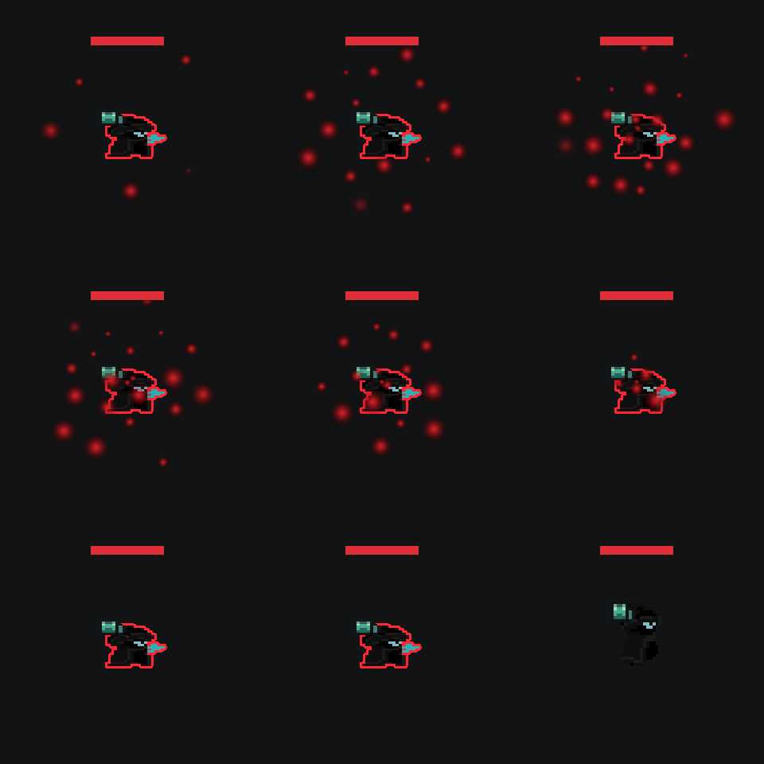

# 공격 준비 파티클

기믹상 명확한 준비 대기가 있는 Enemy18과 Enemy20의 자식 `AttackPreparationModule`에 연결했다. 두 적은 `Assets/_Prefabs/Enemies/Effects/EnemyAttackPreparationModule.prefab`을 중첩 사용하므로 공통 기본값을 한 곳에서 변경하거나 적마다 Override할 수 있다. Enemy17·19·21·22에서는 이 모듈의 연결을 제거했다.

밝은 붉은색 입자가 적의 주변에 순차적으로 생성되어 천천히 출발한 뒤 중심을 향해 점점 빨라진다. 생성 시점에 맞춰 도착 시점도 분산되어 먼저 나온 입자부터 차례로 들어간다. **공격의 기존 준비 시간을 기준으로 파티클을 맞춘다.** 준비 시간이 부족하면 생성과 이동을 함께 압축하여 공격 전에 모두 사라지게 하며, 파티클 때문에 공격을 기다리게 하지 않는다. Unity 기본 `Default-Particle`의 부드러운 알파 텍스처를 전용 Unlit 머티리얼에서 사용한다.

현재는 입자의 자동 이동과 수명 기반 페이드를 사용하지 않는다. 입자별 시작 시각으로 위치를 직접 계산하며, 각 입자의 표시 시간 중 앞 80%에 중심으로 가속 이동하고 마지막 20%에는 **중심에 도착한 상태에서만 축소·페이드**한다. 외부 이동 중에는 끝부분 알파를 줄이지 않는다. 중심에서의 크기도 적 콜라이더 안쪽에 들어가도록 제한한다. 따라서 밖에 남아 있는 입자를 완료 시각에 지워 수렴처럼 보이게 하던 방식이 아니다.

## 조정

| 인스펙터 항목 | 기본값 | 의미 |
| --- | --- | --- |
| Particles Enabled | 켜짐 | 파티클 사용 여부. 컴포넌트를 꺼도 표시와 추가 대기가 해제된다 |
| Gather Time | 0.45초 | 첫 입자 생성부터 마지막 입자가 중심에서 사라질 때까지의 희망 시간. 준비 시간이 부족하면 이펙트만 압축한다 |
| Completion Lead Time | 0.05초 | 공격 전에 입자를 정리할 여유 시간. 준비 시간의 절반을 넘지 않게 제한하며 공격 시간은 늘리지 않는다 |
| Emission Duration Ratio | 0.6 | 전체 시간 중 순차 생성에 쓸 비율. 기본값에서는 0.27초 동안 생성하고 각 입자는 0.18초간 표시한다(이동 0.144초 + 중심에서 소멸 0.036초). 0이면 동시에 생성·도착한다 |
| Particle Count | 40개 | 한 번의 준비 동안 생성할 총개수. 1~128개. 모든 입자가 동시에 화면에 남아 있는 것은 아니다 |
| Particle Color | RGBA (0.85, 0.12, 0.16, 0.95) | 이전보다 밝은 붉은색. 알파도 조정할 수 있다 |
| Spawn Radius | 0.8~1.25 | 입자가 출발할 최소·최대 반경. 월드 유닛 |
| Particle Size | 0.14~0.55 | 입자의 최소·최대 크기. 월드 유닛. 입자마다 무작위로 선택하며 최대 크기를 이전 0.30보다 확대 |
| Center Override | 비어 있음 | 모일 지점을 직접 지정. 비우면 적 루트 콜라이더의 중심을 따라간다 |
| Center Offset | (0, 0) | 중심에서 더할 월드 좌표 보정 |
| Sorting Source | 비어 있음 | 기준 SpriteRenderer. 비우면 초기화 시 적의 첫 SpriteRenderer를 사용한다 |
| Sorting Order Offset | 2 | 기준 그림보다 앞뒤로 그릴 순서 차이 |
| Particle Prefab | AttackPreparationGather | 부드러운 입자 렌더링용 공통 파티클 프리팹 |

기존 준비가 0.6초일 때 기본값에서는 준비 시작 0.1초부터 0.37초까지 입자를 생성한다. 각 입자는 약 0.144초 동안 느리게 출발해 가속하며 중심에 정확히 도착한다. 첫 입자는 약 0.244초, 마지막 입자는 약 0.514초에 중심에 들어간다. 중심에서 약 0.036초 동안 축소·페이드하여 첫 입자는 0.28초, 마지막 입자는 0.55초에 보이지 않게 된다. 그 뒤 시스템을 풀에 반환하고 0.6초에 공격한다. 프레임이 늦어져도 현재 시각의 정확한 위치를 직접 계산하며, 표시 시간이 이미 지난 입자는 그리지 않는다. 공격 시점에는 남아 있는 시스템을 발동 처리 전에 정리한다. 별도의 한 프레임 대기를 공격에 추가하지 않는다.

Gather Time을 0.8초나 3초로 늘려도 준비가 0.6초라면 실제 파티클 재생은 0.55초로 압축되고 공격은 약 0.6초에 발생한다. 공격 준비가 0.2초라면 같은 설정의 파티클은 0.15초 안에서 순차 생성·가속·도착을 마치고 약 0.05초 먼저 사라진다. 준비 시간이 0이면 입자를 만들지 않는다. 공격 준비 시간은 스킬의 Attack Delay와 Post Blink Delay로 조정한다.

게임 코드에서는 `module.ParticlesEnabled = false;`로 끌 수 있다. 준비 중 끄면 재생 중인 입자를 즉시 반환한다. 다시 켰을 때는 다음 공격 준비부터 적용된다. 피격으로 공격이 취소되거나 타깃이 해제되거나 적이 사망·비활성화되면 입자도 즉시 정리한다.

입자는 카메라를 향하는 Billboard로 그리고 가로·세로 크기를 동일하게 사용한다. 속도에 따른 늘이기, 축별 크기 변화, 트레일과 모션 벡터를 사용하지 않도록 프리팹과 풀에서 가져온 인스턴스 모두 설정했다. 연속 입자의 출발 방향도 약 137.5도씩 분산하고 약간의 무작위 각도를 더해, 같은 방향의 입자가 겹쳐 길쭉하게 보이는 경우를 줄였다. 전체 시작 방향은 공격 준비마다 무작위다.

## 재사용과 풀링

`AttackPreparationGather.prefab`을 `LeanPool.Spawn`으로 가져와 재생하고, 발동·취소 시 `LeanPool.Despawn`으로 반환한다. 적마다 별도 ParticleSystem을 계속 생성하지 않으며 같은 풀의 비활성 인스턴스를 재사용한다. 별도의 씬 오브젝트나 PoolManager 연결은 필요하지 않다.

모듈을 제거하거나 비활성화하면 기존 스킬의 준비와 발동이 그대로 동작한다. 파티클의 시간 제어는 이 모듈에 두고, 공용 공격 스킬에는 준비 시작·정리 호출만 둔다. `CanReleaseAttack` 검사와 파티클 완료를 기다리는 프레임 제한은 제거했다. 범위 경고나 저지 불가의 기존 처리는 유지한다.

## 직접 테스트

1. `Assets/_Scenes/Test/EnemyTestScene.unity`에서 Enemy18 또는 Enemy20을 활성화하고 공격을 유도한다. 준비 시작 0.1초 뒤부터 밝은 붉은색 입자가 점차 생성되고, 처음에는 천천히 이동하다가 중심을 향해 가속하며 순서대로 들어가야 한다. 총 40개가 생성되고 마지막 입자가 사라진 뒤 공격해야 한다. Enemy17·19·21·22에는 이 입자가 나타나지 않아야 한다.
2. 해당 적 자식 `AttackPreparationModule`의 Gather Time을 3으로 늘리고 Particle Count를 64로 바꾼다. 입자의 생성과 느린 출발·가속이 준비 시간 안에서 끝나고, 기본 공격 시점인 약 0.6초가 유지되는지 확인한다. Completion Lead Time을 늘리면 입자를 더 일찍 정리하지만 공격 시간은 늘어나지 않는다.
3. Particles Enabled를 끄면 입자 없이 기존 준비 시간대로 공격해야 한다. 준비 중에도 체크를 꺼서 즉시 사라지는지 확인할 수 있다.
4. 준비 중 처치하거나 Particles Enabled를 끈다. 준비의 입자가 남지 않아야 한다. 두 적은 준비 중 저지 불가이므로 일반 피격에는 준비와 입자가 유지된다. 반복 공격 시 Hierarchy의 `LeanPool (AttackPreparationGather)` 아래 인스턴스가 반환되고 다음 공격에 재사용되는지 확인한다.
5. Emission Duration Ratio를 0으로 바꾸면 동시에 생성·도착하는 이전 방식이 된다. 기본값 0.6으로 되돌려 생성과 도착이 순차적으로 나뉘는지 비교할 수 있다.

## 공격 기준 시간 맞춤 검증 — 현재 구현

2026-11-23 도착 위치 보장 방식으로 변경한 뒤 Enemy18·20에서 기본값, Gather Time 3초, 공격 준비 0.2초를 파티클 켬/끔으로 비교해 총 12회 공격을 검증했다. 상세 위치 관측을 위해 이 실행의 Time Scale은 임시로 0.25로 설정했으며 아래 시간은 게임 시간이다. 검증 후 원래 Time Scale을 복원하고 저장 변경 없이 Edit Mode로 돌아왔다.

| 적 / 조건 | 공격 시각: 끔 / 켬 | 관측한 입자 / 소멸 전 중심 도착 | 완전히 사라진 뒤 공격까지 |
| --- | --- | --- | --- |
| Enemy18 / 기본 | 0.600 / 0.601초 | 40 / 40개 | 0.051초 |
| Enemy18 / Gather Time 3초 | 0.601 / 0.600초 | 40 / 40개 | 0.049초 |
| Enemy18 / 준비 0.2초 | 0.201 / 0.202초 | 40 / 40개 | 0.051초 |
| Enemy20 / 기본 | 0.602 / 0.601초 | 40 / 40개 | 0.050초 |
| Enemy20 / Gather Time 3초 | 0.602 / 0.600초 | 40 / 40개 | 0.049초 |
| Enemy20 / 준비 0.2초 | 0.201 / 0.201초 | 40 / 40개 | 0.050초 |

240개 입자 모두 소멸 전에 로컬 중심 좌표에 도착한 것을 각각의 ID로 확인했다. 페이드 중인 입자는 중심 좌표에 있는지와 렌더링 사각형의 네 면이 적 콜라이더 경계 안에 있는지를 검사했으며 모두 통과했다. 기본 설정에서 Enemy18의 초반/후반 이동 속도는 약 2.85/11.39, Enemy20은 약 2.85/11.48유닛/초로 후반 가속을 유지했다. 발동 시 준비 입자는 남지 않았다.

아래 연속 캡처는 왼쪽에서 오른쪽, 위에서 아래 순서다. 준비 시작 후 약 0.13 / 0.20 / 0.27 / 0.34 / 0.41 / 0.48 / 0.53 / 0.57 / 0.60초의 모습이다. 끝부분에는 외부 입자가 남지 않고 이후 공격으로 전환한다.

## 이전 시간 맞춤 방식의 검증

다음 표는 자동 이동·수명 기반 표시를 쓰던 직전 구현의 측정이다. 공격 시간은 맞췄으나, 개별 입자의 정확한 중심 도착이나 중심에서만 페이드하는 것을 보장하는 검증은 아니었다. 현재는 위의 직접 좌표 계산과 전 입자 도착 검사로 교체했다.

2026-11-23 EnemyTestScene에서 Enemy18·20 각각 파티클 켬/끔을 비교했다. 기본값, Gather Time 3초, 공격 준비 0.2초, Completion Lead Time 3초의 네 조건을 두 적에서 확인하여 총 16회 공격을 실행했다. 실제 위치 변화로 초반보다 후반 이동이 빠른 것도 함께 검사했다.

| 조건 | 실제 파티클 재생 시간 | Enemy18 공격: 끔 / 켬 | Enemy20 공격: 끔 / 켬 | 켬 상태의 정리 후 여유 |
| --- | --- | --- | --- | --- |
| 준비 0.6초, 기본값 | 0.45초 | 0.603 / 0.604초 | 0.606 / 0.606초 | 약 0.052~0.054초 |
| 준비 0.6초, Gather Time 3초 | 0.55초 | 0.600 / 0.604초 | 0.603 / 0.602초 | 약 0.050~0.052초 |
| 준비 0.2초, Gather Time 3초 | 0.15초 | 0.203 / 0.205초 | 0.203 / 0.206초 | 약 0.053~0.054초 |
| 준비 0.6초, 모으기·여유 모두 3초 | 0.30초 | 0.605 / 0.604초 | 0.603 / 0.603초 | 약 0.300~0.302초 |

위 표의 마지막 조건은 Gather Time과 Completion Lead Time을 모두 3초로 설정한 경우다. 정리 여유를 준비 시간의 절반인 0.3초로 제한했다. 관측 차이는 프레임 단위 측정에 따른 수 ms 수준이며, 파티클 완료 대기로 공격을 연장하는 코드는 없다. 모든 조건에서 발동 시 활성 준비 파티클은 남지 않았다. 수명 95% 이후 관측한 입자들의 중심까지 남은 거리는 출발 반경 대비 평균 약 6.6~10.9%로, 사라지기 전 중심으로 모이는 것도 확인했다.

## 이전 구현 검증 기록

이하 기록 중 Gather Time 때문에 공격이 늦어지거나 한 프레임을 추가로 기다리던 동작은 현재 구현에서 제거됐다.

가속 방향 변경 전의 `EnemyTestScene` 실행 검증에서는 Enemy18·20의 입자 이동 속도가 초반 약 10.87~16.56, 후반 약 3.48~3.52유닛/초로 감소했다. 입자를 완전히 반환한 뒤 관측상 약 0.043~0.045초 후 공격했으며 전체 준비는 약 0.600~0.603초였다. 당시 Gather Time 0.8초에서는 약 0.855초 뒤 공격했고, 입자를 정리한 프레임에서 발동을 시도해도 다음 프레임까지 차단되는 것을 확인했다. 검증 후 저장된 씬으로 복귀했다.

가시성 조정으로 Gather Time을 0.25초에서 0.5초로 늘리고 Particle Size를 2배로 키웠다. 이후 순차 생성·도착으로 변경한 실행 검증에서는 두 적 모두 처음 1개, 생성 시작 약 0.14초 후 18개가 방출된 것을 확인했다. 총 40개 방출 시점에는 먼저 도착한 입자가 사라져 24개가 남아 있었으며 공격은 준비 시작 약 0.600~0.602초 뒤에 발동했다. 분산 비율 0, 입자 1개, 준비 중 표시 해제와 풀 반환도 확인했다.

2026-11-23 최종 실행 검증: Enemy18에서 관측한 시작 크기는 0.164~0.530, Enemy20은 0.150~0.537이었다. 두 적 모두 현재 입자의 X/Y 크기 비율은 1이며, `BakeMesh`로 읽은 실제 Billboard의 가로·세로 비율도 오차 범위 내 1:1(최대 1.00000048)이었다. 따라서 검사한 화면에서는 개별 입자의 렌더링 지오메트리가 길게 늘어나지 않았다. 기존 설정도 Billboard였으므로 특정 Stretch 설정 하나가 원인이었다고 단정하지 않는다. 겹침 가능성까지 함께 줄인 조정이다.

최종 각도 분산 적용 후에도 입자 정리와 공격 사이에 Enemy18 약 0.045초, Enemy20 약 0.049초의 빈 구간이 관측됐다. 검증은 저장된 EnemyTestScene에서 임시 오브젝트로 진행했고, 종료 후 Edit Mode 및 미변경 씬 상태로 돌아왔다.

최종 컴파일 실패와 현재 Console 오류는 0이었다. 활성 Enemy17~22·Boss23 프리팹 7개의 Missing Script가 없고, 준비 모듈이 Enemy18·20에만 연결되며 두 적 모두 공통 파티클 프리팹과 0.14~0.55 크기 설정을 참조하는 것을 확인했다.

2026-11-23 가속 방향 변경 후 실제 입자 위치의 프레임 간 변화를 측정했다. 개별 입자 수명의 10~30% 구간과 70~90% 구간을 비교했으며, Enemy18은 평균 약 2.20→9.29유닛/초, Enemy20은 약 2.24→9.26유닛/초로 빨라졌다. 두 적 모두 전체 준비는 약 0.601~0.602초였고, 입자가 완전히 정리된 뒤 약 0.050초 후 공격했다. 크기·색·개수·순차 방출과 기존 연결은 유지했다. 마지막 고정 이미지는 가속 방향 변경 전 크기·배치 참고용이다.

## 사용한 문법과 이유

- `[SerializeField]`, `[Min]`, `[Range]`로 설정을 인스펙터에 노출하고 시간과 개수의 입력 범위를 정했다. 새 스탯이나 공용 시스템을 추가하지 않고 적별로 조정할 수 있다.
- `GatheringParticle`은 출발 위치와 크기를 묶는 값 형식 `struct`다. 이 데이터와 `ParticleSystem.Particle` 배열을 최초 사용 또는 개수 증가 시 확보하고 다시 사용한다. 프레임마다 입자별 GameObject나 배열을 만들지 않는다.
- `for`로 각 입자의 예정 생성 시각과 현재 경과 비율을 계산하고 `ParticleSystem.SetParticles`로 표시할 입자만 전달한다. `main.simulationSpeed = 0f`로 자동 이동을 멈추고, 자동 색·크기·속도 모듈도 꺼 수명 기준 소멸이 직접 계산을 덮어쓰지 않게 한다.
- `Vector3.LerpUnclamped(출발점, Vector3.zero, t * t)`로 로컬 원점을 향해 가속 이동한다. `t`를 `Mathf.Clamp01`로 제한하므로 끝에 반드시 원점에 도착하고 지나치지 않는다. 전체 표시 시간의 80%에 이동을 마친 뒤 나머지 20%에만 중심에서 축소·페이드한다. 이전의 속도 곡선 적분에 의존하지 않는다.
- `Random.Range(float, float)`로 입자마다 크기를 뽑는다. 방향은 황금각 상수와 방출 순번으로 분산한 뒤 작은 난수를 더한다. 연속 입자의 방향이 뭉치는 것을 줄이면서 공격마다 다른 배치를 만든다. `startSize3D = false`와 `sizeOverLifetime.separateAxes = false`는 X/Y 크기가 따로 변하지 않게 한다.
- `Mathf.Min`으로 실제 재생 시간을 `희망 Gather Time`과 `공격 준비 시간 - 정리 여유` 중 작은 값으로 제한한다. 시작 시각을 공격 시점에서 역산하므로 순차 생성과 가속이 같은 준비 구간 안에서 끝난다. `EnemyAttackSkill`은 완료를 기다리는 조건 없이 원래 발동 시점에 입자를 정리하고 공격한다.
- `?.`는 모듈이 연결된 경우에만 호출하는 null 조건 연산자다. 모듈이 없는 적도 공용 스킬을 계속 사용할 수 있다.
- `OnDisable()`에서 모듈 상태와 파티클을 정리하고 Lean Pool에 반환한다. 모듈 제거·적 비활성화·사망 중에도 다음 재사용에 이전 입자가 남지 않도록 했다.
