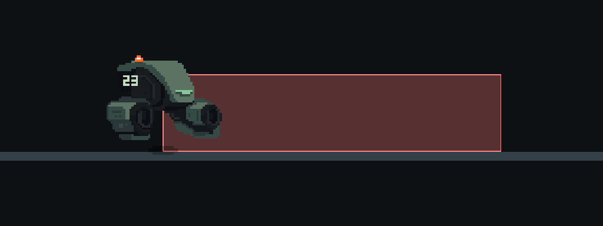

# Enemy23 공중 고도와 돌진 경고

작업일: 2026-11-24. 이전 GIF 개선 이후의 추가 조정이다.

이후 변경: [Boss23SpacingNotes.md](Boss23SpacingNotes.md). 현재 고도는 **4.5유닛**, 돌진은 **앞쪽 절반**부터 경고와 피해가 시작된다. 아래 5.5유닛·전체 몸통 내용은 이 경고를 처음 연결했을 때의 기록이다.

## 변경과 조정 위치

- 보스 루트 `ProductionControlDrone > Air Attack Altitude`: **6.5 → 5.5유닛**. 아레나 바닥부터 보스 루트까지의 높이다. 공중 전환·레이저·폭격이 같은 고도를 사용한다. 일반과 강화 모두 이 공통 높이를 사용하며, 이동 속도와 피해 수치는 변경하지 않았다.
- `Charge` 스킬의 `Telegraph Prefab`에 **Boss23_ChargeWarning**을 연결했다. 기존 `AttackTelegraphUI`와 기본 Canvas Image 5개(채움 1개·테두리 4개)를 사용하며 새 런타임 클래스는 만들지 않았다.
- 경고는 돌진 준비 중에 표시하고 돌진 시작 시 끈다. 강화의 두 번째 돌진은 재조준 동안 표시하며, 재조준 방향이 바뀌면 범위도 갱신한다. 각 돌진 중에는 방향이 고정된다.
- 보스 몸통의 피해 판정 범위와 실제 돌진 구간을 합친 사각형을 사용한다. 벽·절벽·아레나 경계로 돌진이 짧아지면 기존 이동 계획 함수를 통해 경고도 짧아진다. 보스의 1.35배 스케일도 월드 좌표로 반영한다.
- 후딜·취소·비활성화 시에는 기존 스킬 정리 로직으로 경고를 숨긴다. 준비 시간을 늘리거나 별도 점멸을 추가하지 않았다.

경고 색은 기존 `Boss23_TargetBombWarning`에서 복사했다. 포격 프리팹과 실시간으로 색을 공유하는 구조는 아니다.

| 항목 | 현재 값과 수정 위치 |
| --- | --- |
| 채움 색 | `Boss23_ChargeWarning > AttackTelegraphUI > Area Color`: RGB (1, 0.55, 0.55), 알파 **0.09** |
| 테두리 색 | 자식 `Top / Bottom / Left / Right > Image > Color`: 같은 RGB, 알파 **0.9** |
| 테두리 두께 | **0.025유닛**. Top/Bottom의 Height, Left/Right의 Width |
| 경고 시간 | Charge의 기존 준비 시간: 일반 **0.55초**, 강화 **0.46초**. 강화 재조준은 **0.34초** |

## 직접 테스트

1. `Assets/_Scenes/Test/EnemyTestScene.unity`를 열고 플레이어와 Enemy23을 활성화한 뒤 실행한다.
2. 공중 전환 시 이전보다 1유닛 낮은 지점에 멈추고, 그 높이에서 레이저나 폭격으로 이어지는지 확인한다.
3. 추적에서 보스가 몸을 낮춰 충전할 때 연붉은 사각형과 테두리가 나타나고, 실제 돌진 시작과 동시에 꺼지는지 확인한다. 현재 몸통 위치부터 돌진 끝의 몸통 위치까지가 범위다.
4. 좌우에서 각각 유도한다. 벽이나 절벽 근처에서는 표시가 이동할 수 있는 구간까지만 나와야 한다.
5. 강화 상태의 두 돌진 사이에도 경고가 보이고, 재조준이 끝난 뒤에는 돌진 방향이 바뀌지 않는지 확인한다.

## 실행 검증

EnemyTestScene Play Mode의 격리된 테스트 배치에서 지상 7개·공중 7개·흐름 5개 시나리오를 검사했다. 기존 씬 오브젝트는 검사 후 복원하며 씬을 저장하지 않는다.

- 기본/강화 돌진의 준비·재조준 중 표시, 돌진·후딜 중 비표시 확인.
- 실제 이동 계획의 몸통 스윕과 경고 사각형의 월드 좌표 일치 확인.
- 왼쪽 벽 앞 범위 축소와 공격 취소 후 Canvas 비표시 확인.
- 일반/강화의 공중 도착 고도 **5.5유닛**, 레이저·폭격 판정과 고정 표식 확인.
- 기본 연사 7발·7회 섬광, 기존 반격 시간 및 35% 발악 진입 흐름 회귀 확인.

결과: [지상](Boss23ChargeWarningGroundVerification.json), [공중](Boss23ChargeWarningAirVerification.json), [흐름](Boss23ChargeWarningFlowVerification.json).

실행 중 캡처: 

## 사용 문법과 이유

- **`out Vector2 destination`**: 기존 이동 계획 함수가 계산한 실제 목적지를 받는다. 경고를 위해 벽·절벽 검사 로직을 별도로 복제하지 않는다.
- **`Bounds.center / Bounds.size`와 `Mathf.Abs`**: 이동 거리의 절반만큼 중심을 옮기고, 절댓값만큼 가로 길이를 늘려 좌우 모두 같은 계산으로 전체 피해 구간을 표현한다.
- **`Telegraph?.Hide()`**: 경고 프리팹이 연결되지 않은 테스트 배치에서도 널 예외 없이 기존 돌진이 동작하도록 한다.
- **RectTransform의 Anchor**: 네 테두리를 사각형의 상하좌우에 고정한다. 돌진 거리 때문에 가로 길이가 바뀌어도 별도 셰이더 없이 테두리 위치와 두께를 유지한다.

에셋 연결 보조 도구는 `SetupBoss23ChargeWarning.Run`, 검증은 `VerifyBoss23Rework.CheckAssets / RunGround / RunAir / RunFlow`다.
