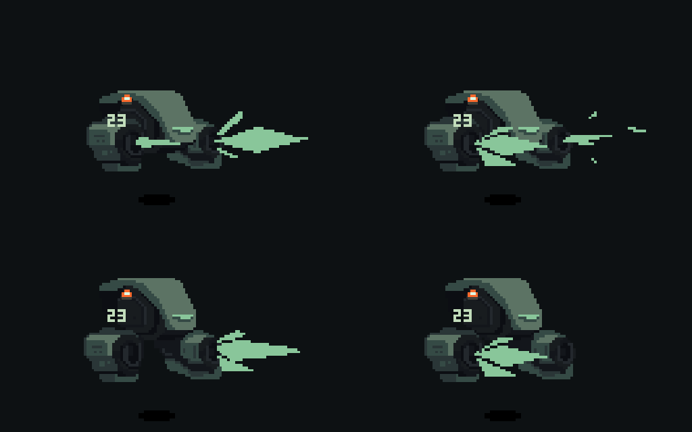

# Enemy23 강화 GIF 참고 개선

작업일: 2026-11-24. `C:/Users/USER/Pictures`의 강화 공중 전환·강화 연사·강화 추적·강화 폭격 GIF를 파일명 기준으로 프레임별 확인했다. 분석용 모음은 [Boss23EnhancedGifReference](Boss23EnhancedGifReference)에 저장했다. 원본 GIF는 수정하지 않았다.

## 기본·강화의 공통 부분

- 기존 5개 스킬과 지상 3개 → 공중 2개 선택 흐름을 유지한다.
- 기본과 강화 모두 같은 준비 자세·경고 프리팹·몸통/그림 이동 보간을 사용한다.
- 돌진은 기본의 `CrouchCharge / GroundRush`를 공유한다. 강화는 기존처럼 빠른 2연속 돌진이며 중간 재조준과 각 돌진 중 방향 고정을 유지한다.
- 사각형 돌진 경고·앞쪽 절반 판정·6.5유닛 목표 거리 및 아레나 경계/지형 제한은 변경하지 않았다.
- 공중 고도 4.5유닛, 패턴 후 1.25초 반격 시간을 유지한다. 강화의 공중 부유·배기도 기본과 같은 비주얼 모듈을 사용한다.
- 35% 진입 시 기존 편도 레이저 1회의 흐름은 유지한다. 이 진입 전환에는 일반 공중 패턴의 네 번 사격을 추가하지 않는다.

## 연사

기본은 기존처럼 수평으로 7회 발사한다. 강화는 12회 × 3발, 총 36발이며, 탄도는 전방 **수평·12도 위·24도 위**다. 왼쪽을 향해도 수평 탄이 가장 낮고 나머지 둘은 위쪽이다. `Last Stand Spread Angle`이 인접 탄 사이 각도이며 기본값은 12도다.

기본·강화 모두 한 번 발사할 때 섬광이 한 번 발생하고, 앞·뒤 런처가 교대한다. `SalvoSingleShot / SalvoRearShot` 클립과 `GroundFirePoint / SalvoRearShotPoint` 총구를 함께 교대해 그림과 실제 발사 원점을 맞췄다. 강화 발사 클립 속도는 1.2로 맞춰, 짧은 교대 클립이 0.144초 발사 주기 안에 끝나게 했다.

3유닛 거리 유지, 가감속과 호버링, 막혔을 때 제자리 사격, 플레이어가 뒤로 넘어가면 그 연사 동안 이동을 잠그는 규칙을 유지한다.

## 공중 전환의 네 번 사격

일반과 강화 모두 변형과 상승을 완료한 뒤 사격한다. 상승 도중 강화 샷건을 먼저 발사하던 처리는 제거했다.

| 항목 | 일반 | 강화 |
| --- | --- | --- |
| 발사 동작 | 4회 | 4회 |
| 동작 1회당 발사체 | 조준탄 1발 | 조준 방향 기준 4발 샷건 |
| 총 발사체 | **4발** | **16발** |
| 사격 간격 | 0.38초 | 약 0.317초 (0.38 / 1.2) |
| 샷건 전체 퍼짐각 | 해당 없음 | **24도** (조준 방향에서 -12/-4/+4/+12도) |

매 사격마다 플레이어 중심을 다시 조준하고, 해당 묶음의 발사체는 생성 시 정한 방향으로 날아간다. `AirShotFront / AirShotRear` 클립으로 앞·뒤 런처를 네 번 교대한다. 클립 하나에 앞뒤 섬광을 모두 넣어 동작 수가 두 배로 보이게 하지 않는다.

조정 위치는 `AirTransition / DroneAirTransitionSkill`의 **Shot Interval 0.38**, **Shot Duration 0.24**, **Shotgun Angle 24**, **Last Stand Speed Multiplier 1.2**다. 사격 모션을 끝내고 비행 기본 자세로 돌아온 뒤 다음 사격을 진행한다. 마지막 사격 뒤 기존 Post Attack Delay를 거쳐 다음 공중 패턴으로 이어진다.

## 표적 폭격

일반·강화 모두 같은 `Normal Radius Pixels` 값을 읽는다. **52.5px / 28PPU = 반경 1.875유닛**으로 예고와 실제 폭발 판정이 일치한다. 따로 커지는 강화 반경 필드는 제거했다.

기존의 기본 3회·강화 6회, 피해 22/26은 유지한다. 강화는 기존처럼 0.508초 간격·표식 생성 후 1.15초 만에 착탄한다. 포격 애니메이션과 고정 표식은 기본을 공유하며, 강화도 공중에서 표적 쪽으로 부드럽게 이동한 뒤 포격 모션과 현재 이동을 마치고 하강한다. 강화 수평 속도는 기본 3.2 × `Last Stand Movement Speed Multiplier 1.2` = **3.84유닛/초**다.

## 직접 테스트

1. `Assets/_Scenes/Test/EnemyTestScene.unity`에서 플레이어와 Enemy23을 활성화하고 실행한다.
2. HP 35% 초과에서 연사의 앞뒤 런처 교대, 공중 전환 완료 후 4회·4발 사격을 본다. 공중 사격 사이에 이동해 재조준도 확인한다.
3. HP를 35% 이하로 낮춘다. 기존 진입 레이저가 끝난 뒤 강화 패턴을 확인한다.
4. 강화 연사를 좌우에서 각각 유도한다. 가장 낮은 탄은 수평이어야 하고, 12번의 교대 섬광에 총 36발이 나와야 한다. 뒤로 넘어가도 사격 방향을 바꾸면 안 된다.
5. 강화 공중 전환은 완전히 상승한 뒤 앞·뒤·앞·뒤로 4회 발사해야 한다. 매번 좁은 4방향 샷건으로 총 16발이다.
6. 강화 폭격은 빠르게 6회 진행하지만 표식과 폭발 반경은 기본과 같아야 한다. 생성된 표식은 플레이어를 따라오지 않아야 한다.
7. 강화 추적은 기존 사각형 경고를 거쳐 빠르게 두 번 돌진하고, 후딜에서는 기본 자세로 쉬어야 한다.

클립 비교: 위쪽은 연사, 아래쪽은 공중 사격이며 각 줄의 왼쪽은 앞 런처, 오른쪽은 뒤 런처다.

## 검증 자료

EnemyTestScene에서 **29개 시나리오**를 통과했다(지상 8·공중 7·흐름 5·거리/판정 9). 일반/강화 공중 사격에서 모두 상승 완료와 같은 프레임에 첫 사격이 시작됐으며, 앞·뒤·앞·뒤 네 번 섬광과 4/16발을 확인했다. 강화 연사는 좌우 모두 최하단 수평 탄도와 12회 교대 섬광·36발을 확인했다. 기본/강화 폭격의 같은 반경 1.875유닛, 고정 표식, 원래 발수·착탄 시간과 공중 이동도 확인했다. 스킬·총구·클립 참조 누락이 없고, 컴파일 오류 없이 실행했다. 씬 파일은 수정하지 않았으며 검증용 Play Mode는 종료했다.

[지상·좌우 탄도](Boss23EnhancedGifGroundVerification.json), [공중·샷건·폭격](Boss23EnhancedGifAirVerification.json), [흐름·반격 시간](Boss23EnhancedGifFlowVerification.json), [거리 유지·고정 돌진](Boss23EnhancedGifSpacingVerification.json).

## 사용 문법과 이유

- **나머지 연산 `% 2`**: 발사 횟수의 홀짝으로 앞뒤 런처·클립을 교대한다. 일반과 강화가 같은 방식을 쓴다.
- **`Mathf.Sin / Cos`**: 좌우 어느 방향에서도 위쪽으로만 퍼지는 연사 탄도를 만든다. X에만 방향 부호를 적용해 왼쪽 사격의 탄도가 아래로 뒤집히지 않게 한다.
- **`Mathf.Lerp`**: 강화 공중 샷건 네 발을 좁은 전체 각도 안에서 균등하게 배치한다.
- **`const int VolleyCount = 4`**: 요청된 네 번 사격을 하나의 기준으로 사용한다. 시간 경과를 쫓아 한 프레임에 여러 사격 모션을 건너뛰지 않고 각 모션이 끝난 뒤 다음 모션을 진행한다.
- **총구 Transform 참조**: 런처 교대를 스프라이트에만 적용하지 않고 실제 발사체의 원점도 해당 런처로 맞춘다. 자식이므로 보스의 좌우 반전과 부유를 함께 따른다.

연결 도구: `SetupBoss23EnhancedGifs.Run`, 클립 확인: `SetupBoss23EnhancedGifs.Preview`. 게임 실행용 클래스나 새 매니저는 추가하지 않았다.
