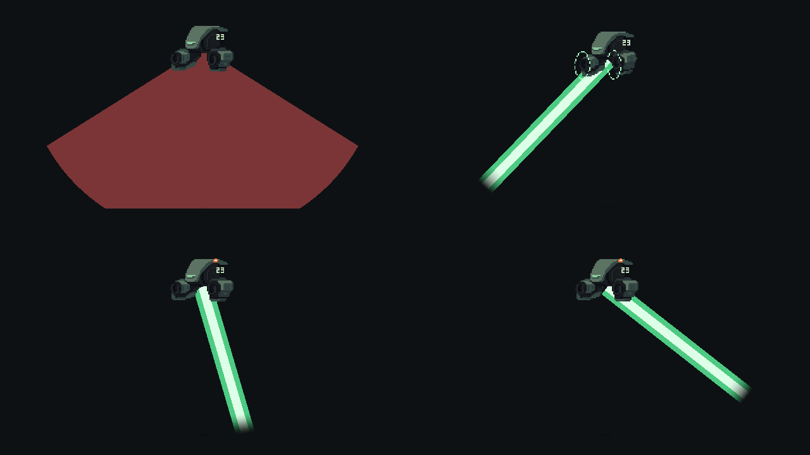

# Enemy23 부채꼴 레이저와 23 표기

작업일: 2026-11-24. 레이저 한 줄이 아레나 위쪽 중앙에서 아래쪽 부채꼴 영역을 왼쪽→오른쪽으로 훑는다. 부채꼴 전체를 동시에 공격하지 않는다. 기존 스킬 모듈·FSM·사격/폭탄 패턴을 사용하고, 노션 기획서는 수정하지 않았다.

## 동작과 조정

체력이 50% 이하일 때 기존 후반 패턴 선택으로 레이저를 시작한다. 플레이어 X를 따라 올라가던 방식에서 **아레나 중앙 X와 레이저 전용 높이**로 이동하도록 변경했다. 공격 준비 시작 시 발사 원점을 고정하고, 그 원점에서 회전한다. 폭탄의 고도는 기존 High Altitude를 사용한다.

| 인스펙터 위치 / 필드 | 기본값 | 의미 |
| --- | --- | --- |
| Enemy23 루트 / Laser Altitude | 6.5 | 바닥 기준 보스 이동 높이. 월드 유닛 |
| DownwardLaser / Length | 7.5 | 대각선 끝에서의 최대 길이. 바닥이나 Terrain Layers의 지형이 더 가까우면 그곳에서 끝남 |
| DownwardLaser / Width | 0.8 | 월드 기준 레이저 전체 두께 |
| DownwardLaser / Sweep Half Angle | 60도 | 수직 아래에서 좌우 각각의 요청 각도. 실제 각도는 안전 폭을 지키도록 제한 |
| DownwardLaser / Safe Edge Width | 1.25 | 아레나 좌우 각각에 남길 안전 폭. 레이저 두께까지 포함해 보호 |
| DownwardLaser / Max Speed | 140도/초 | 회전 시작 속도. Min Speed까지 SmoothStep으로 감속 |
| DownwardLaser / Min Speed | 50도/초 | 회전 끝 속도. 회전 시간은 실제 각도와 두 속도에서 계산 |
| DownwardLaser / Fade Out Duration | 0.08초 | 회전을 완료한 뒤 빔이 빠르게 투명해지는 시간. 추가 피해 없음 |
| DownwardLaser / End Fade Distance | 1 | 끝부분 및 바닥 근처의 투명 그라데이션 거리. 월드 유닛 |
| DownwardLaser / Boss Laser Shake / Amplitude | 0.25 | 발사 중 일정하게 유지하는 흔들림 세기. 0이면 끔 |
| DownwardLaser / Boss Laser Shake / Frequency | 32 | 흔들림의 변화 빈도 |
| DownwardLaser / Boss Laser Shake / Fade Out Duration | 0.08초 | 회전 종료 후 흔들림을 부드럽게 줄이는 시간 |
| 기존 Attack Delay | 0.9초 | 공격 준비 시간 |

안전 폭은 BossArenaModule의 Half Width에 따라 정한 양쪽 벽에서 계산한다. 테스트의 폭 16유닛 아레나에서는 양 끝 1.25유닛을 침범하지 않도록 실제 회전이 약 -57.85도→+57.85도로 제한됐다. 최대 길이와 바닥 높이 때문에 실제 바닥의 안전 공간은 이 최소 폭보다 넓을 수 있다. 안전 공간을 모두 차지할 만큼 너무 좁은 아레나에서는 레이저를 계획하지 않고 다른 패턴을 검토한다.

준비 경고는 `Boss23_LaserWarning.prefab`의 기존 Canvas UI와 ConvexPolygonGraphic을 사용한다. 전체 회전 중 레이저 사각형들을 감싸는 볼록 다각형을 만들고, 바닥 및 안전 구역 경계로 잘라 표시한다. 경고와 실제 공격 모두 같은 발사 위치·회전각·길이·두께를 사용한다. 레이저는 한 번의 발사에서 플레이어에게 최대 한 번 피해를 준다.

## 회전 감속, 정렬과 지속 흔들림

기존 Active Duration 대신 Max Speed와 Min Speed로 회전 시간을 결정한다. 단위는 이동 속도가 아닌 **회전 속도(도/초)**다. 실제 전체 각도 ÷ 두 속도의 평균으로 시간을 구하므로, 현재 테스트 아레나에서는 약 1.218초 동안 회전하고 0.08초 동안 사라진다. 두 값을 같게 설정하면 등속 회전한다. 역전해 입력하면 큰 값을 시작 속도로, 작은 값을 끝 속도로 사용한다.

속도를 시간에 따라 SmoothStep으로 줄이고, 그 속도를 적분한 각도를 사용한다. 프레임 간격과 무관하게 동일한 시점의 각도를 계산하며, 마지막에 목표 각도에 도달한다. 페이드 중에는 마지막 방향을 유지하고 추가 피해를 검사하지 않는다. 발사 초반의 짧은 페이드 인과 바닥 근처의 공간 그라데이션은 유지한다.

레이저의 Body Renderer에 몸체 HitVisual을 연결했다. 초기화와 발사 시 같은 Sorting Layer를 사용하고 몸체보다 Order in Layer를 1 낮게 적용한다. 현재 몸체는 10, 레이저는 9이므로 빔과 겹쳐도 몸체가 위에 보인다. 보스 전체의 정렬 레이어를 바꾸려면 몸체의 설정을 기준으로 조정한다.

DownwardLaser 자식에 기존 BossLaserShake를 재사용했다. 준비 중에는 흔들지 않고, 빔 발사부터 회전 끝까지 강도 배율 1을 유지한다. 회전이 끝나면 짧게 감쇠하고 종료·취소·비활성화 시 자기 흔들림 이벤트를 정리한다. 이 보스에서는 기존 횡단 보스의 SetTraversalProgress를 호출하지 않으므로 End Strength는 회전 중 강도에 영향을 주지 않는다.

수신 카메라에는 Impulse 채널 마스크에 **64**가 포함된 Listener가 필요하다. EnemyTestScene의 Main Camera에는 이미 Channel Mask 64인 Cinemachine External Impulse Listener가 있고, Player 프리팹의 카메라 Listener는 모든 채널(-1)을 수신하도록 오버라이드되어 있는 것을 확인했다. 별도의 카메라·씬 파일은 수정하지 않았다. 같은 카메라에 동일 채널 Listener를 중복 추가하면 흔들림이 겹칠 수 있다.

## 레이저 끝 그라데이션

기존 Beam 스프라이트를 전용 `DroneLaserFade.mat`와 `DroneLaserFade.shader`로 그린다. 원래 녹색 외곽과 밝은 중심을 유지하며, 빔의 끝까지 남은 거리 및 바닥에서의 높이로 알파를 SmoothStep 처리한다. 대각선 끝이 바닥보다 위에 있어도 끝부분이 흐려지고, 중앙에서 바닥에 닿을 때도 단면이 딱 끊어지지 않는다. 바닥 아래 픽셀은 투명하게 처리한다.

MaterialPropertyBlock으로 각 레이저의 원점·방향·길이·바닥 높이를 전달하므로, 공유 머티리얼을 보스마다 복제하지 않는다. 보스의 루트 배율을 보정해 표시 두께와 길이를 판정의 월드 단위에 맞췄다.

## 23 표기

우측을 보는 원본 기준으로 ProcessNumber를 오른쪽으로 2원본 픽셀 옮겼다. PPU 28 기준 로컬 X는 -0.625에서 약 -0.553571로 변경했다. 단순히 프리팹의 Transform만 바꾸면 Animator가 덮어쓰기 때문에, 사망을 제외한 10개 클립의 ProcessNumber X 위치 키도 같은 양만큼 이동했다. 각 모션의 상하·좌우 움직임과 경광등 위치는 유지한다. 좌우 반전 시 숫자의 가독성을 유지하는 기존 flip 처리도 사용한다.

## 확인한 내용

EnemyTestScene에서 런타임 테스트 오브젝트를 사용했다. 저장된 씬과 사용자의 보스 루트 배율 1.35·비활성 상태를 변경하지 않았다. 테스트 인스턴스만 활성화했다.

- 실제 FSM이 아레나 중앙·바닥 위 6.5유닛으로 상승하고 부채꼴 경고를 표시했다.
- 좌측 x=-7.5 및 우측 x=7.5 안전 구역에서는 각각 피해 0회였다.
- 중앙에서는 레이저를 따라 18 피해가 정확히 한 번 발생했다.
- 한 프레임에 0.8초 분량의 회전이 건너뛴 상황을 만들어 중간 각도에 있는 타깃이 빠지지 않는 것을 확인했다.
- 회전 중 실제 스프라이트 사각형의 모든 X 경계가 양 끝 안전 폭을 침범하지 않았다. 비활성·스케일 1.35인 사용자 프리팹도 그대로 유지됐다.
- 투명 RenderTexture에서 읽은 바닥 위 0.1/0.5/1.3유닛 지점의 알파는 각각 약 0 / 0.255 / 1이었다. 실제 렌더링의 그라데이션과 셰이더 오류 0건을 확인했다.
- 10개 모션의 숫자와 경광등 사이 상대 위치를 검사해 2픽셀 이동과 기존 프레임별 움직임이 함께 유지되는 것을 확인했다.
- 컴파일 오류 0건, 보스 의존 에셋 154개·애니메이션 11개 참조 검사를 통과했다. 종료 후 저장 변경 없는 EnemyTestScene Edit Mode로 복귀했다. 작업 전부터 있던 씬 파일 변경은 저장하거나 되돌리지 않았다.
- 감속 설정의 시작·끝 실측 속도는 약 140.001 / 50.002도/초였다. 100구간을 검사해 속도가 부드럽게 감소하는 것을 확인했다. Width 1.4, Max/Min 90/90, Fade Out 0의 별도 설정도 정상 회전·두께·판정·종료를 확인했다.
- 발사 중 흔들림 배율 최소/최대가 모두 1이었다. 채널 64의 실제 Impulse와 테스트 카메라 Listener가 적용한 최대 위치 변화는 약 0.25유닛으로 일치했다. 종료 및 중도 취소에서 빔과 지속 흔들림이 모두 정리됐다.
- 0.08초 페이드의 0/25/50/75/100% 시점 알파는 약 1 / 0.844 / 0.5 / 0.156 / 0이었다. 실제 프레임에서도 반투명 빔이 표시된 후 사라졌다.

Console에는 테스트 씬에 LinearStageGenerator가 없다는 기존 MinimapCanvas 경고가 있었다. 컴파일 중에도 허용 영역 밖의 빈 HeathenEngineering.UX.asmdef 경고가 기록됐으며, 두 영역은 수정하지 않았다. 최종 Console 오류는 0건이었다.

아래 이미지는 준비 경고, 좌측 발사, 중앙 통과, 우측 발사 순서다.

## 직접 테스트

1. EnemyTestScene에서 Enemy23을 활성화한다. 현재 사용자 프리팹의 기본 비활성 상태는 보존했으므로 실행 중 인스턴스를 켜서 확인할 수 있다.
2. 아레나의 Half Width와 바닥 감지를 확인하고, 체력을 최대의 50% 이하로 낮춘다. 보스가 중앙 위로 상승해 준비 경고를 표시해야 한다.
3. 양쪽 끝에서 발사 전체를 기다려 피해가 없는지 보고, 중앙에서 한 번의 피해가 발생하는지 비교한다. 레이저는 빠르게 시작해 천천히 회전하며, 발사 중 카메라가 일정한 강도로 흔들리고 회전 완료 후 빔과 흔들림이 빠르게 사라져야 한다. 보스 몸체가 빔 위에 보이는지도 확인한다.
4. SkillModule > DownwardLaser에서 Width, Max Speed, Min Speed, Fade Out Duration을 하나씩 조정한다. Width를 늘리면 표시·경고·판정이 함께 넓어지며 안전 폭을 지키도록 실제 회전각이 줄어든다. 두 속도를 같게 하면 등속으로 회전한다. 흔들림은 같은 오브젝트의 Boss Laser Shake > Amplitude로 조절한다.
5. 대기·상승·충전·발사·하강 중 23이 몸체에 붙어 있는지와 좌우 반전 시 읽는 방향이 유지되는지 확인한다.

현재 검증 도구는 `VerifyBoss23FanLaser.cs`의 `Enter`, `Run`, `CheckAssets`다. 저장된 EnemyTestScene에서 Enter로 진입한 뒤 Run을 실행하고, 이 도구가 시작한 Play Mode를 종료한다. 기존 VerifyBoss23의 RunPlay는 변경 전 수직 레이저를 검사하던 과거 경로이며 이번 패턴의 실행 검증에는 사용하지 않는다. 해당 파일의 CheckAssets는 기존 스킬/애니메이션 참조 확인용으로 계속 사용한다.

## 사용한 문법과 이유

- `[SerializeField]`, `[Min]`, `[Tooltip]`으로 비공개 설정을 인스펙터에 노출하고 단위와 사용처를 표시했다. 폭·속도·페이드를 코드 수정 없이 조정하기 위해 사용한다.
- `Sin/Cos`로 수직 아래 기준의 방향을 계산하고 `Asin`으로 아레나 폭·레이저 길이·두께에서 허용 회전각을 역산한다. `SmoothStep(t) = 3t² - 2t³`으로 속도를 줄이고, 그 적분 `t³ - 0.5t⁴`를 각도 계산에 사용한다. 각도를 단순 보간하는 방식과 달리 시작·종료 속도가 설정한 도/초 값과 일치하고 프레임 간격의 영향을 줄인다.
- `?.`는 선택 연결인 카메라 흔들림 모듈이 있을 때만 호출하는 null 조건 연산자다. `sortingLayerID`와 `sortingOrder`를 몸체 기준으로 설정해 빔의 화면 겹침 순서를 맞춘다. 종료 알파도 `Mathf.SmoothStep`으로 보간해 갑자기 꺼지는 인상을 줄였다.
- `Physics2D.OverlapBox`의 회전 인자로 현재 레이저의 실제 방향을 검사한다. 프레임 사이의 이동 각도를 레이저 폭보다 작은 간격으로 나눠 검사하므로 빠른 회전이나 낮은 프레임률의 누락을 줄인다.
- 정렬된 점과 외적 부호를 사용하는 볼록 껍질 계산으로 회전 중 사각형들의 전체 경고를 만든다. 평면 경계 클리핑으로 바닥·안전 구역 밖을 제거한다. 기존 Canvas Graphic에 좌표만 전달한다.
- `MaterialPropertyBlock`은 공유 머티리얼을 바꾸거나 복제하지 않고 이 Renderer의 셰이더 값만 설정한다. 셰이더는 월드 좌표의 `dot`으로 빔 끝까지의 거리를 구해 `smoothstep`으로 투명도를 보간한다.
- `AnimationUtility.GetEditorCurve/SetEditorCurve`로 번호의 X 키 값만 이동한다. 기존 Keyframe의 시간·탄젠트·Y 모션을 유지하여 모션과 표식이 따로 놀지 않게 한다.
