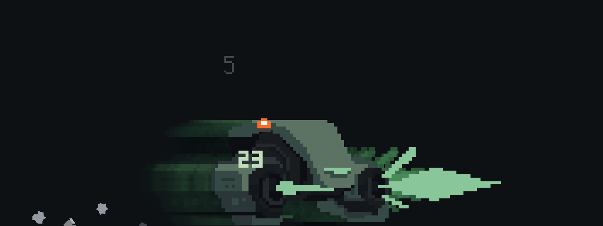
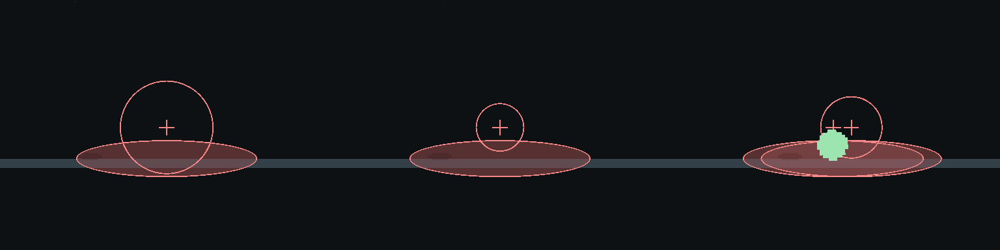

# Enemy23 자세·이동·발사 피드백 수정

이 문서는 직전 피드백의 기록이다. 현재 동작·수치·반격 시간은 **[Boss23MotionNotes.md](Boss23MotionNotes.md)**를 따른다. 아래 이전 설정 도구는 현재 프리팹에 다시 실행하지 않는다.

작업일: 2026-11-24. Enemy23의 5패턴 구현 후 받은 추가 요청과 1.5초 연사 요청을 함께 반영했다. 노션과 테스트 씬은 수정하지 않았다.

## 변경 내용과 조정 위치

프리팹: `Assets/_Prefabs/Enemies/Bosses/Enemy23/Boss23_ProductionControlDrone.prefab`

| 위치 | 설정 / 동작 |
| --- | --- |
| SkillModule / Charge | Distance **6.5**. 최고 Speed 8, 강화는 12로 2연속. 지형에 막히면 가능한 구간까지만 이동한다. |
| SkillModule / RapidFire | Firing Duration **1.5**. 기본 7발, 강화 12회 × 3방향 = 36발. 마지막 발사까지 1.5초이며, 준비·모션 마무리·후딜은 별도다. |
| SkillModule / RapidFire | Retreat Distance 3, Retreat Speed **4**. 새 감속 이동으로 1.5초 안에 3유닛 후퇴한다. 벽·절벽 앞에서는 이동을 제한하고 발사는 계속한다. |
| FlightModule / BossFlightModule | **Decelerate From Start** 켜짐. 시작부터 빠르게 움직이고 도착할수록 0까지 부드럽게 감속한다. Enemy23의 돌진·후퇴·상승·하강·복귀에 적용한다. 끄면 기존 가속·등속·감속 방식이다. |
| AfterImageModule | Spawn Interval **0.018**, Lifetime **0.22**, Ghost Color 알파 **0.28**. 빈도·유지 시간·색을 여기서 조절한다. |
| SkillModule / FanLaser | **Repeat Pause 0.25**. 강화 첫 횡단의 모션·페이드 종료 후 대기하고, 기존 Attack Preparation 설정으로 다시 경고한 뒤 반대 방향으로 두 번째 발사한다. |
| SkillModule / TargetBomb | Last Stand Interval **0.75**, Last Stand Drops 6. 기본은 1초 간격 3발이다. |
| Boss23_Bomb 프리팹 / EnemyLobProjectile | Flight Duration **0.96**, Arc Height **4.6**. 위로 솟았다가 고정된 경고 위치로 떨어진다. |
| Boss23_TargetBombWarning 프리팹 / DroneBombTargetGraphic | Countdown Radius **1**. 이전 0.48보다 크게 시작하고 실제 비행 시간 안에 줄어든다. 색·선 두께·십자 높이는 기존 필드로 조정한다. |

빠르게 시작하는 감속 방식의 평균 속도는 지정 최고 속도의 절반이다. 총 이동 시간은 `2 × 거리 / 최고 속도`다. 예를 들어 6.5유닛·최고 속도 8인 기본 돌진은 약 1.63초 걸린다. 이 옵션을 켜면 기존 Ease Duration 대신 전체 구간에 걸친 감속을 사용한다. 다른 보스 프리팹에서는 옵션을 자동으로 켜지 않았다.

## 자세와 잔상

첨부 이미지에 맞춰 돌진·연사에 **Crouch/transition.png**, **Crouch/speedy shot.png**를 연결했다. CrouchCharge와 CrouchFire 애니메이션을 새로 만들었으며, 자세별 원점과 23 표식·경광등 위치를 맞췄다. 지상 전용 GroundFirePoint도 낮춘 총구 위치에 연결했다. 공중 레이저의 원본 모션은 별도로 사용한다.

잔상은 기존 AfterImageGhost 컴포넌트와 ObjectPool을 그대로 쓰되, **적 전용 Boss23_SmoothAfterImage 프리팹**에서 일반 Sprite Unlit 머티리얼을 사용한다. 짧은 간격으로 원형을 유지한 잔상이 겹치고 전체 알파가 연속으로 줄어든다. 원본 픽셀 아트의 픽셀 형태는 유지하며 별도의 픽셀 분해·소멸 연출은 넣지 않았다. 플레이어 프리팹과 공용 플레이어 머티리얼은 변경하지 않았다.

## 레이저와 폭격 타이밍

강화 레이저는 같은 스킬 사용 안에서 **첫 경고 → 첫 발사 → 페이드·모션 마무리 → 대기 → 두 번째 경고 → 반대 방향 발사 → 페이드** 순서로 실행한다. 재경고는 EnemyAttackSkill.BeginPreparation을 다시 사용하므로 Attack Delay / Post Blink Delay / Blink 설정이 첫 경고와 동일하게 적용된다. 대기·재경고 중에는 빔·피해·레이저 흔들림이 없고, 각 발사 중에는 일정한 흔들림을 준다. 35% 진입용 기본 편도 레이저는 계속 한 번만 실행한다.

폭격은 원래 BombCharge/Bomb 애니메이션을 사용하고, 강화에서도 Bomb 모션을 1배속으로 끝까지 재생한다. 재생 길이 약 0.725초가 0.75초 간격 안에 들어간다. 각 경고는 발사 당시의 플레이어 아래 바닥에 고정된다. 원이 더 커진 만큼 초당 줄어드는 거리도 늘었고, 축소 완료 시점은 실제 착탄과 일치한다.

## 실행 검증

EnemyTestScene의 실행 사본에서 원본 루트를 잠시 비활성화하고, 검증용 바닥·피해 수신 대상·카메라·보스 프리팹으로 검사한 뒤 복원했다. 검증이 시작한 Play Mode는 종료했다. 씬 파일 해시는 작업 전후 동일하며 편집 씬에 미저장 변경을 남기지 않았다.

전체 시나리오는 약 **36.8초**, **14개 결과 항목 통과**다. [원본 결과 JSON](Boss23FeedbackVerification.json)에 기록했다.

- 감속 이동: 최고 속도 6인 검사에서 초반 평균 약 **5.87**, 마지막 평균 약 **0.048**로 줄고 정확히 3유닛에 도착했다.
- 기본·강화 돌진: **6.5유닛 × 1 / 2회**, 접촉 피해 1 / 2회. Crouch 스프라이트 사용과 잔상 최대 12개를 확인했다.
- 기본·강화 연사: **1.5초에 7 / 36발**, 3유닛 후퇴. 후퇴가 벽에 막히면 이동 0유닛으로도 발사를 완료했다. 낮춘 자세와 수평·3방향 발사도 확인했다.
- 공중 전환: 공통 높이 6.5, 기본 상승 샷건 0발 / 강화 5발을 확인했다.
- 강화 레이저: **별도 발사 2회**, 사이 대기·재경고가 실제로 있었고 그동안 피해와 흔들림이 없었다. 발사마다 피해 1회와 반대 방향 복귀를 확인했다.
- 폭격: **3발·1초 / 6발·0.75초**, 원본 Bomb 모션 사용. 발사점보다 최대 약 **1.69유닛 상승**했고 경고 위치 고정·원 축소·착탄 시 숨김을 확인했다.
- 무작위 선택 400회와 35% 진입용 기본 상승·편도 1회도 재검증했다.
- 프리팹 5개 스킬, Crouch 클립 2개, 잔상 참조와 의존 에셋 164개를 확인했다. 컴파일 오류와 최종 실행 중 오류는 없었다. 테스트 씬의 기존 미니맵 경고는 수정하지 않았다.

## 직접 테스트

1. EnemyTestScene에서 플레이어와 Enemy23을 켜고 Play 한다. 아레나 중앙 위 6.5유닛까지 공간과 충분한 바닥을 확보한다.
2. 지상에서 돌진·연사를 관찰한다. 둘 다 낮춘 총구 자세여야 하며, 돌진은 최고 속도에서 점점 느려지고 잔상은 전체 형태를 유지한 채 옅어진다. 연사는 1.5초 안에 기본 7발을 발사한다.
3. 보스를 벽 가까이에 두어 후퇴가 막혀도 연사가 끝나는지 확인한다. 돌진 앞의 벽·절벽도 넘지 않아야 한다.
4. 폭격 경고 직후 움직여 본다. 폭탄이 위로 솟고, 경고는 따라오지 않으며 큰 원이 사라지는 시점에 폭발해야 한다.
5. HP를 35% 이하(최대 550 기준 192.5 이하)로 내린다. 진입 레이저 이후 36발 연사, 2연속 돌진, 별도 재경고가 있는 레이저, 0.75초 간격 6발 폭격을 확인한다.

## 사용한 문법과 이유

- **SerializeField bool**: BossFlightModule에 감속 방식을 선택하는 옵션만 추가했다. Enemy23 프리팹에서 켜며 기존 다른 보스의 이동 설정은 그대로 쓸 수 있다.
- **SmoothStep 속도의 적분**: 매 프레임 위치를 Lerp하면 목표에 무한히 가까워지는 방식이 되기 쉽다. 출발점과 누적 시간을 기준으로 `2t - 2t³ + t⁴` 위치 비율을 계산해 빠르게 시작하고 정확한 목표에서 속도 0으로 끝낸다.
- **상태를 나타내는 bool과 반복 번호**: 레이저의 대기와 재준비를 구분한다. 스킬 자체를 끝냈다가 다시 뽑지 않고 같은 스킬 안에서 BeginPreparation을 재호출해 다른 패턴이 끼어들지 않게 했다.
- **SpriteRect의 Custom Pivot**: 프레임별로 다른 여백 때문에 자세가 바뀔 때 몸체가 튀지 않도록 스프라이트 원점을 맞췄다. 기존 spriteID는 보존했다.
- **ObjectPool + 기존 DOTween 알파 페이드**: 잔상 컴포넌트를 재사용하면서 적 전용 프리팹의 머티리얼만 교체했다. 새 코루틴·패키지는 추가하지 않았다.

재연결 도구는 `SetupBoss23Feedback.Run`이다. 최초 5패턴 구성을 다시 생성할 때는 `SetupBoss23Rework.Run` 이후에 실행한다. 검증은 `VerifyBoss23Rework.CheckAssets / Run`을 사용한다.
