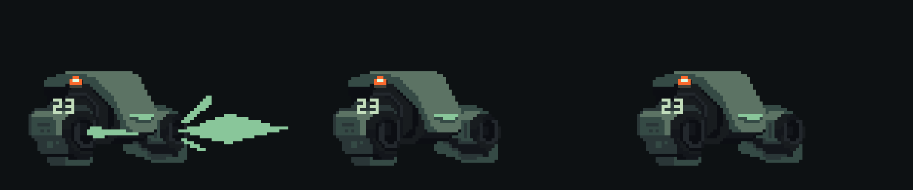

# Enemy23 기본 패턴 — GIF 참고 개선

작업일: 2026-11-24. 첨부 GIF를 파일명 기준 공중 전환·연사·추적·표적 폭격으로 구분해 프레임별로 확인했다. 원본 GIF는 수정하지 않았다.

사용자 확인에 따라 **공중 전환 다음 레이저·폭격을 선택하는 기존 흐름을 유지**하며, 이번 변경은 기본 패턴에만 적용한다. 강화 발동을 끄지 않았으며 기존 강화 수치·동작을 이번 GIF에 맞춰 변경하지 않았다.

## 적용한 모습과 움직임

- **공중 전환**: 기본 상승만 최고 속도 6.5로 조정해 변형·상승이 너무 급하게 끊기지 않게 했다. 고도에서 살짝 떠 있는 움직임과 작은 배기 입자를 추가했다. 부유 효과는 움직이기 시작하거나 멈출 때 서서히 섞인다. 강화와 발악 진입 상승은 기존 속도를 사용한다.
- **추적**: 기본 준비 자세는 몸을 낮추는 CrouchCharge, 돌진은 전방 분사가 이어지는 GroundRush를 사용한다. 기존 잔상과 가감속·비주얼 보간을 함께 사용한다. 공격 종료 후 기본 자세로 돌아와 쉬는 흐름과 방향 고정 규칙은 유지한다.
- **연사**: 기본 전용 SalvoSingleShot을 만들었다. 전방 섬광 한 프레임 구간 → 섬광 없는 낮춘 자세 → 다음 발사 순서다. 원본 speedy shot 시트의 뒷포구 섬광 프레임을 넣지 않아 **탄 한 발당 섬광 한 번**만 보인다. 마지막 모션이 끝나면 바로 Idle에서 쉰다.
- **표적 폭격**: BombCharge/Bomb 원본 포격 애니메이션은 그대로 사용한다. 기본 폭격 중에는 플레이어 옆 공중 지점으로 부드럽게 위치를 조정하고, 마지막 포격 모션과 현재 이동을 마친 뒤 하강한다. 표식이 생성된 뒤에는 폭탄과 경고 위치가 고정된다.

GIF의 전체 길이나 예시 화면의 모든 발수를 그대로 복사한 것은 아니다. 현재 프로젝트의 기본 피해·발수·발사 간격, 공중 후속 패턴 연결, **1.25초 반격 시간**을 기준으로 준비·분사·이동·복귀의 느낌을 맞췄다. 새로운 패턴 시스템이나 매니저를 만들지 않고 기존 스킬과 비주얼 모듈을 수정했다.

## 연사 섬광 확인

아래는 실제 연결된 기본 연사 클립의 발사 순간·섬광 종료·대기 자세를 엔진에서 렌더링한 것이다. 전방 섬광 이후 뒷포구가 다시 번쩍이는 프레임은 없다.

기본 연사 7발과 벽에 막힌 연사 7발 모두 실행 중 밝은 섬광 시작을 **정확히 7번** 관찰했다. 구조 검사에서도 클립의 큰 섬광 구간이 한 번이며 나머지는 movingt 기본 자세임을 확인했다. 강화는 기존 CrouchFire를 사용한다.

## 조정 위치

프리팹: `Assets/_Prefabs/Enemies/Bosses/Enemy23/Boss23_ProductionControlDrone.prefab`

| 위치 | 설정 |
| --- | --- |
| AirTransition / Normal Ascent Speed Multiplier | **0.65**. 루트 Ascent Speed 10 × 0.65 = 기본 상승 최고 6.5 |
| VisualModule / Basic Hover Amplitude | **0.06유닛**, 0이면 공중 부유 흔들림 없음 |
| VisualModule / Basic Hover Frequency | **1.4**, 공중 부유 주기 조정 |
| Visual / BasicFlightExhaust | 기존 ParticleSystem. 수명·크기·방출 수·색을 조정 가능, 최대 **24개** |
| TargetBomb / Normal Hover Speed | **3.2**, 기본 폭격 중 수평 위치 조정 속도 |
| TargetBomb / Normal Hover Offset | **1.2유닛**, 플레이어와 수평으로 남기는 거리 |
| RapidFire / Firing Animation Speed | 기존 **1.2**, 기본 단발 섬광 클립의 재생 속도 |
| 루트 / Pattern Recovery Time | 기존 **1.25초**, 패턴 사이 반격 시간 |

폭격 공중 위치는 아레나 안으로 제한하고 기존 지형 검사로 이동 경로를 확인한다. 매 프레임 이동 계획을 재시작하지 않고 현재 구간을 마친 뒤 다음 위치를 정해 가감속이 계속 초기화되는 현상을 피했다. 입자는 보스 안의 ParticleSystem 하나를 재사용하며 매 프레임 오브젝트를 생성하지 않는다. 기존 AttackPreparationParticle 머티리얼도 재사용했다.

## 실행 검증

EnemyTestScene의 실행 사본에서 **18개 항목**을 통과했다. 테스트가 시작한 Play Mode는 종료했으며, 편집 씬은 미저장 변경이 없고 씬 파일 해시는 작업 전후 동일하다.

- 기본 연사: 7발·7회 섬광, 0.32초 간격·탄당 10, 방향 고정·벽 앞 제자리 발사 확인.
- 기본 추적: 낮춘 준비·전방 분사·잔상·6.5유닛 돌진·종료 후 Idle·피해 18 확인.
- 기본 공중 전환: 약 **2.17초**, 고도 도착과 같은 프레임에 사격하고 AirIdle로 복귀. 배기 입자 재생 확인.
- 기본 폭격: 검증 중 약 **2.50유닛 수평 이동**, 3회 투하·경고 위치 고정·피해 22·폭발 대기 확인.
- 반격 시간: 지상·공중 사격·폭격 후 **약 1.25초** 동안 새 공격·물리 이동이 없고 피해를 받는지 확인.
- 강화는 기존 동작과 일치하는지 회귀 검사만 했다. 강화 폭격의 수평 이동은 0, 새 배기 입자도 꺼져 있었다.
- 강화 설정 전체와 **BombCharge/Bomb을 포함한 원본 클립 10개**의 SHA256을 비교해 작업 전후 동일함을 확인했다.
- 스크립트 누락과 스킬·애니메이션·입자 참조 확인, 컴파일·실행 오류 없음. 기존 미니맵 경고는 수정하지 않았다.

결과: [지상](Boss23GifGroundVerification.json), [공중](Boss23GifAirVerification.json), [흐름·반격 시간](Boss23GifFlowVerification.json).

## 직접 테스트

1. EnemyTestScene에서 플레이어와 Enemy23을 켠다. 기본 패턴 확인 동안 HP를 35%보다 높게 유지한다.
2. 연사에서 탄이 나올 때만 전방 섬광이 한 번 생기고, 뒷포구가 다시 번쩍이지 않는지 본다. 충전 중 빛나는 것과 발사 섬광은 구분한다.
3. 추적에서 몸을 낮춘 뒤 분사·잔상과 함께 돌진하고, 끝나면 기본 자세로 쉬는지 본다. 준비·돌진 중 뒤로 넘어가도 방향이 고정되어야 한다.
4. 공중 전환의 상승·부유·배기를 확인한다. 사격 뒤 잠시 쉬고 기존 레이저·폭격 선택으로 이어져야 한다.
5. 폭격 중 좌우로 움직여 본다. 보스는 공중에서 위치를 조정하지만 이미 나타난 표식은 따라오지 않아야 한다. 보스의 발사 모션은 기존 포격 모션이어야 한다.
6. 각 패턴이 끝났을 때 가까이 붙어 반격한다. 이번 수정으로 기존 강화 패턴이 바뀌지 않았는지도 HP를 낮춰 비교할 수 있다.

## 사용한 문법과 이유

- **조건 연산자 `?:`**: 기본 전용 클립과 기존 강화 클립을 선택한다. 강화 설정을 건드리지 않으면서 기본 모습만 조정한다.
- **Animator의 스프라이트 키**: 반복 재생이 아닌 ‘섬광 한 번 → 일반 자세’로 구성한다. 실제 발사 함수가 한 번 호출될 때 클립도 한 번 시작한다.
- **Mathf.Sin + MoveTowards**: 공중에서 작은 상하 움직임을 주고, 정지·이동 전환 때 부유 효과가 갑자기 켜지지 않게 한다.
- **기존 이동 모듈과 경로 검사**: 폭격은 기존 비행 이동을 재사용하고, 목적지까지의 경로가 비어 있을 때만 움직인다. 새 이동 시스템을 만들지 않는다.
- **ParticleSystem 모듈 값**: 기존 Unity 입자 시스템에서 방출 수·수명·속도·색을 지정한다. 한 시스템을 계속 재사용하므로 입자마다 GameObject를 만들지 않는다.

기본 GIF 조정 재연결 도구: **SetupBoss23GifReference.Run**. 검증: **VerifyBoss23Rework.CheckAssets / RunGround / RunAir / RunFlow**. GIF 프레임 분석 자료는 Tools~/CTJ/Boss23GifReference에 있으며 원본 GIF 파일은 그대로다.
