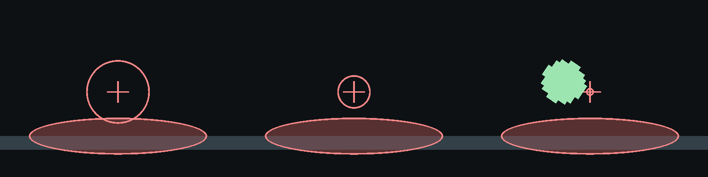

# Enemy23 공정 통제 드론 — 5패턴 재작업

갱신일: 2026-11-24. 이번 문서가 기존 50% 전환·강약 살보 교대 기획을 대체한다. 노션 문서는 수정하지 않았다.

## 패턴 선택과 LAST STAND

지상에서는 **추적 돌진 / 연사 / 공중 전환** 중 현재 사용 가능한 것을 같은 확률로 고른다. 공중 전환이 끝나면 다른 지상 패턴을 끼우지 않고 **사선 레이저 / 표적 폭격** 중 하나를 고른다. 두 공중 공격은 모두 아레나 중앙 X, 바닥 기준 **6.5유닛** 높이를 사용하고 공격 후 지상으로 복귀한다. 쿨타임·사거리·지형 조건을 만족하지 못한 후보는 제외한다.

실제 HP가 최대의 **35% 이하**가 되면 LAST STAND를 한 번 예약한다. 현재 진행 중인 동작을 마친 뒤, 기존처럼 중앙으로 상승해 **기본 편도 레이저를 한 번** 발사한다. 이 진입 동작에는 5방향 상승 샷건이나 왕복 레이저 강화를 붙이지 않는다. 진입 레이저가 끝나면 하강·휴식 후부터 강화 패턴을 사용한다. 취소돼 실제 발사하지 못한 진입 예약은 유지한다.

HP 판정은 부동소수점 계산의 미세한 오차까지 포함해 35% 경계를 처리한다. 현재 최대 HP 550에서는 약 **192.5 이하**다. 강화 여부는 각 스킬의 준비 시작 시 고정하므로 진행 중인 발수·횟수가 도중에 바뀌지 않는다.

| 패턴 | 기본 | LAST STAND |
| --- | --- | --- |
| 추적 돌진 | 지상에서 플레이어 방향으로 3유닛, 속도 8. 레이저 모션·잔상 사용 | 속도 12(1.5배), 새 플레이어 방향으로 2연속 |
| 연사 | 약 2.5초에 7발, 직선 수평 발사. 상하 ±0.3유닛 무작위 발사 위치 | 같은 시간에 12회 × 전방 3방향, 총 36발 |
| 공중 전환 | 공중 공통 위치로 부드럽게 상승 | 상승 시작 시 플레이어를 겨눈 5방향 샷건 1회 |
| 사선 레이저 | 기존 부채꼴 편도 1회 | 회전 속도 1.25배, 편도+복귀 2회 |
| 표적 폭격 | 3회 투하, 1초 간격 | 6회 투하, 0.5초 간격 |

피해량은 프로토타입 기존 값을 재사용한다. 돌진은 접촉당 14(돌진 1회당 최대 한 번), 작은 레이저는 8, 부채꼴 레이저는 횡단당 18, 폭탄은 착탄 반경 1.3유닛에서 20이다. 플레이어의 무적·회피 판정은 기존 공용 피해 처리에 따른다.

## 이동과 표시

기존 BossFlightModule의 가속·감속 이동을 지상과 공중에서 재사용한다. 돌진과 후퇴는 벽, 아레나 경계, 바닥 끊김을 검사한다. 연사는 플레이어와 반대 방향으로 최대 3유닛 후퇴하며, 움직일 수 없으면 제자리에서 발사한다. 후퇴 중에도 발사 방향은 플레이어가 있는 좌우를 향한다. 기본 연사의 탄 자체는 위아래로 조준하지 않는다.

돌진은 Laser 모션을 사용하며 빔을 실제로 발사하지 않는다. 기존 AfterImageGhost 스프라이트 잔상 컴포넌트와 프리팹을 재사용하고, EnemyAfterImageModule의 ObjectPool로 잔상을 재사용한다. 플레이어 코드나 플레이어 프리팹은 수정하지 않았다.

사선 레이저의 기존 폭, 끝 그라데이션, 몸체와의 겹침, 일정한 카메라 흔들림과 빠른 종료 페이드는 유지한다. 강화 왕복 중에는 빔이 꺼지지 않고, 마지막 복귀가 끝난 뒤에만 페이드한다. 기하와 머티리얼 원리는 [Boss23FanLaser.md](Boss23FanLaser.md)에 있다.

기존 몸체·23 표식·경광등 애니메이션, 보스 체력바, 피격·사망 이펙트, 사망 애니메이션 후 코인 보상 흐름은 유지한다. 루트 활성 여부와 사용자 배율 1.35도 보존했다.

## 폭격 경고

각 투하마다 그 시점 플레이어 아래의 바닥 위치를 고정한다. 그다음 플레이어가 움직여도 해당 폭탄과 경고는 그 점을 따라가지 않는다. 다음 투하는 새 플레이어 위치를 다시 읽으므로 여러 경고가 서로 다른 곳에 나타날 수 있다.

전용 **Canvas UI**로 바닥의 타원·중앙 십자·줄어드는 원을 그린다. 바닥 타원의 가로 범위가 공격 반경에 대응한다. 축소 원은 폭탄의 실제 FixedUpdate 비행 진행률을 읽으며 착탄 프레임에 경고가 꺼진다. 폭탄은 기존 EnemyLobProjectile의 비행·폭발 애니메이션·범위 피해를 재사용한다. 기본 비행 시간은 0.8초, 낮은 포물선 높이는 0.25다.

이미 발사된 폭탄과 경고는 시전자 스킬이 중단돼도 독립적으로 남아 착탄까지 진행한다. 유효한 바닥이나 비행 경로를 찾을 수 없으면 새 투하만 중단한다.

## 인스펙터 조정

프리팹은 Assets/_Prefabs/Enemies/Bosses/Enemy23/Boss23_ProductionControlDrone.prefab이다.

| 위치 | 주요 설정 |
| --- | --- |
| 루트 ProductionControlDrone | Last Stand Health Ratio 0.35, Low Altitude 0.9, Air Attack Altitude 6.5, Ascent Speed 6, Air Recovery Time 1.2 |
| SkillModule / Charge | Distance 3, Speed 8, Ease Duration 0.08, Repeat Delay 0.12, Damage 14 |
| SkillModule / RapidFire | Firing Duration 2.5, Normal Volleys 7, Last Stand Volleys 12, Last Stand Spread Angle 12도, Vertical Spawn Offset 0.3, Retreat Distance 3, Retreat Speed 1.5 |
| SkillModule / AirTransition | Shotgun Angle 60도, Projectile Speed 10, Projectile Range 16, Damage 8 |
| SkillModule / FanLaser | Width 0.8, Max Speed 600도/초, Min Speed 50도/초, Fade Out Duration 0.14, Body Overlap Distance 0.35, Safe Edge Width 1.25 |
| SkillModule / TargetBomb | Normal Drops 3, Last Stand Drops 6, Normal Interval 1, Last Stand Interval 0.5, Radius 1.3 |
| AfterImageModule | Spawn Interval 0.035, Lifetime 0.18, Ghost Color |
| Boss23_Bomb 프리팹 | Flight Duration 0.8, Arc Height 0.25 |
| Boss23_TargetBombWarning 프리팹 | Color, Line Width, Ellipse Height Ratio, Cross Height/Size, Countdown Radius |

같은 이름의 Base Cool Time은 공용 스킬 쿨타임이며 패턴별로 유지한다. 후퇴가 벽에 막히더라도 연사의 발수와 시간은 줄이지 않는다. 돌진은 지형이 막으면 갈 수 있는 구간까지만 이동한다.

## 직접 테스트

1. **EnemyTestScene**에서 Enemy23과 플레이어를 활성화한다. 아레나 바닥 레이어와 폭을 맞추고 중앙 위 6.5유닛까지 공간을 확보한다. 테스트 때문에 씬을 바꾸거나 저장할 필요는 없다.
2. 최대 HP 상태에서 여러 패턴을 관찰한다. 지상 돌진, 후퇴 연사, 공중 전환이 무작위로 나오고, 상승 직후에는 레이저 또는 폭격이 이어져야 한다.
3. 연사 중 벽 뒤에 보스를 두어 후퇴가 막히면 제자리에서 7발을 모두 발사하는지 확인한다. 각 탄의 발사 높이가 조금씩 달라야 한다.
4. 폭격 경고가 생기자마자 좌우로 이동한다. 기존 경고는 고정되고 다음 경고만 새 위치를 사용해야 한다. 원이 십자를 향해 줄어들고 사라질 때 해당 지점에 폭발이 발생해야 한다.
5. 실제 표시 HP를 **35% 이하(550 기준 192.5 이하)**로 낮춘다. 현재 패턴 후 기본 상승·편도 레이저를 한 번 실행하고, 이후에는 2돌진·36발 연사·상승 5발·왕복 레이저·6회 폭격으로 강화되는지 확인한다.
6. 이동 중 가속·감속, 돌진 잔상, 레이저 흔들림·페이드와 지상 복귀를 본다. 마지막에는 기존 사망 연출·체력바 닫힘·코인 보상도 확인한다.

현재 생성 도구는 **SetupBoss23Rework.Run**, 실행·참조 검증은 **VerifyBoss23Rework.CheckAssets / Run / RunEntryOnly**다. EnemyTestScene에서 VerifyBoss23FanLaser.Enter로 Play Mode에 들어간 뒤 새 검증 도구를 실행하고, 이 도구가 시작한 Play Mode를 종료한다. 예전 SetupBoss23/SetupBoss23FanLaser, VerifyBoss23Patterns 및 VerifyBoss23.RunPlay는 변경 전 기획용이므로 현재 5패턴 검증·재생성에는 사용하지 않는다.

## 실제 검증 결과

2026-11-24, 열려 있던 EnemyTestScene의 Play Mode 사본에서 격리 실행했다. 최종 전체 시나리오 실행 시간은 약 32초이며 13개 결과 항목을 통과했다. 원본 씬의 루트들은 테스트 중에만 비활성화하고 복원했으며, 테스트가 시작한 Play Mode도 종료했다. 씬 파일의 SHA256은 작업 전후 동일하다.

| 확인 항목 | 실측·결과 |
| --- | --- |
| 기본 돌진 | 3유닛, 1회 접촉 피해, 동시 잔상 최대 5개 |
| 발악 돌진 | 3유닛씩 2연속, 2회 접촉 피해, 속도 12 |
| 기본 / 발악 연사 | 약 2.5초, 7회·7발 / 12회·36발, 각각 3유닛 후퇴 |
| 벽에 막힌 연사 | 이동 0유닛, 7발 정상 발사 |
| 기본 / 발악 상승 | 공통 높이 6.5, 상승 샷건 0발 / 5발 |
| 기본 / 발악 레이저 | 편도 1회·속도 600 / 왕복 2회·속도 750, 횡단별 피해·연속 흔들림·종료 정리 확인 |
| 기본 / 발악 폭격 | 3회·1초 간격 / 6회·0.5초 간격, 모든 경고 고정·원 축소·착탄 시 숨김 확인 |
| 무작위 선택 | 지상 240회: 돌진 82 / 연사 69 / 상승 89. 공중 160회: 레이저 83 / 폭격 77 |
| 35% 경계 | 36%에서는 진입하지 않고, 정확히 35%에서 진입. 진입용 편도 1회와 상승 샷건 없음 확인 |
| 프리팹·컴파일 | 5개 고유 스킬 등록, 누락 스크립트 없음, 의존 에셋 166개 확인. 컴파일 오류 0, 이번 수정 코드에서 발생한 경고 없음 |

전체 결과는 [Boss23ReworkVerification.json](Boss23ReworkVerification.json)에 저장했다. 테스트 도중 발견한 잔상 풀의 파괴된 오브젝트 정리 예외는 null 확인으로 수정했으며, 수정 후 전체 실행과 Play Mode 종료에서 새 오류가 발생하지 않았다. 기존 PlayerMeleeAttackSkill.combotime의 미사용 필드 경고와 EnemyTestScene에 LinearStageGenerator가 없는 미니맵 경고는 수정하지 않았다. 이번 검증은 패턴 규칙·타이밍·참조를 확인한 것으로, 실제 게임 아레나에서의 난이도와 시각적 속도감은 위 직접 테스트로 조정한다.

## 사용한 문법과 이유

- enum과 switch로 지상 선택·상승·공중 선택·복귀를 구분한다. 공중 전환 뒤 지상 패턴이 끼지 않게 선택 단계를 나눴다.
- List<EnemyAttackSkill>를 Clear/Add로 재사용하고 Random.Range(0, Count)로 현재 가능한 후보를 같은 확률로 선택한다. 프레임마다 새 목록을 만들지 않는다.
- 스킬 시작 때 강화 여부를 bool에 저장해 진행 도중 HP가 바뀌어도 발수와 반복 횟수가 바뀌지 않게 한다. LAST STAND 진입 예약은 별도 bool로 유지한다.
- while로 이미 지난 발사 시점을 따라잡아 프레임이 늦어도 7·12·3·6회 횟수를 빠뜨리지 않는다. 시간은 모두 Time.time과 FixedUpdate를 사용한다.
- 원형 탄막과 3·5방향 탄은 Quaternion.Euler로 방향만 회전한다. 수평 기본 탄은 Vector2.right에 좌우 부호를 곱한다.
- Physics2D의 BoxCast와 Raycast로 이동 전 벽과 바닥을 확인하고, 빠른 돌진은 이전·현재 몸체 사이의 전체 사각 범위를 검사해 접촉 피해 누락을 줄인다.
- 기존 AfterImageGhost와 ObjectPool<T>를 조합해 플레이어 전용 방출 코드에 의존하지 않고 잔상을 재사용한다. 새 코루틴은 추가하지 않았다.
- 폭격 경고는 MaskableGraphic.OnPopulateMesh와 VertexHelper로 타원·십자·원을 그린다. FlightProgress를 읽어 축소 원과 실제 착탄을 같은 물리 진행률에 맞춘다.
- Mathf.Approximately는 35% 계산의 미세한 부동소수점 오차 때문에 정확한 경계 진입이 누락되는 것을 막는다.
- 이번 파일도 LOCAL.md의 기능별 빈 줄 규칙을 적용했다. Boss23ReworkSpacing.md에 서식 전후 코드 토큰 동일성 검사를 기록했다.
