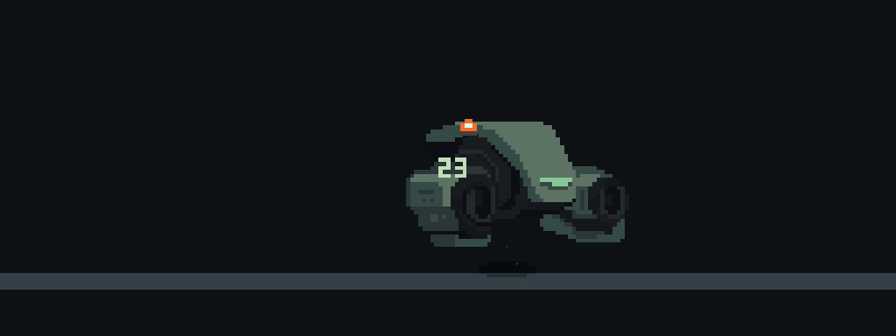

# Enemy23 돌진 가속과 연사 호버링

작업일: 2026-11-24. [기존 거리·판정 규칙](Boss23SpacingNotes.md)을 유지하면서 속도와 비주얼을 조정했다.

## 변경과 조정 위치

| 인스펙터 위치 | 설정 | 현재 값 |
| --- | --- | --- |
| Charge / DroneChargeSkill / Normal Timeline | Dash Duration | **1 → 0.8초** |
| Charge / DroneChargeSkill / Last Stand Timeline | Last Stand Dash Duration | **0.68 → 0.55초** (돌진 1회당) |
| VisualModule / DroneVisualModule / Salvo Movement Hover | Salvo Hover Height | **0.18유닛** |
| 같은 곳 | Salvo Hover Amplitude | **0.1유닛** |
| 같은 곳 | Salvo Hover Frequency | **초당 2회** |

돌진 거리는 여전히 **6.5유닛**이다. 같은 거리를 더 짧은 시간에 이동하므로 평균 속도는 일반 약 25%, 강화 약 24% 증가한다. 기존 이동 모듈의 가감속을 유지하며, 공격 준비·재조준·반격 시간과 피해량은 변경하지 않았다. 벽·절벽·아레나 경계 제한도 유지한다.

이전 부유 효과는 공중에서 정지한 경우에만 작동해 지상 연사 이동에는 적용되지 않았다. 이제 일반/강화의 연사 이동 중 비주얼을 띄우고, 작은 상하 진동을 더한다. 완전히 적용되었을 때 기준 위치보다 **0.08~0.28유닛** 위에 표시된다. 이동 시작·종료에 약 0.17초 동안 효과를 섞어 갑자기 뜨거나 내려오지 않게 한다.

물리 몸통과 땅 판정은 지상 위치에 유지한다. 총구와 배기처럼 Visual의 자식인 요소는 보스 그림과 함께 움직인다. 기존 BasicFlightExhaust 입자 시스템도 연사 이동 중 재생하며 새 입자 시스템이나 오브젝트를 반복 생성하지 않는다. 이동이 막히거나 플레이어가 뒤로 넘어가 멈추면 부유는 부드럽게 내려오고, 기존 방향으로 남은 사격을 마친다.

부유 높이를 높이려면 Height, 상하 흔들림을 키우려면 Amplitude, 흔들리는 속도를 바꾸려면 Frequency를 수정한다. Height와 Amplitude를 모두 0으로 하면 연사 중 수직 부유 움직임이 사라진다.

## 직접 테스트

1. `Assets/_Scenes/Test/EnemyTestScene.unity`에서 플레이어와 Enemy23을 활성화하고 실행한다.
2. 장애물이 없는 방향으로 돌진을 유도한다. 이전보다 빠르게 6.5유닛을 이동하며, 앞쪽 절반 판정과 명중 후 완주가 유지되어야 한다.
3. 연사 시작 시 가까이 서서 후퇴하게 하거나 멀리 서서 접근하게 한다. 몸체가 지면에서 더 떠 있고 상하로 부드럽게 움직이며, 아래쪽으로 작은 배기 입자가 나오는지 본다.
4. 연사 중 목표 거리인 3유닛에 도달하거나 보스 뒤로 넘어간다. 이동과 부유가 멎고, 발사 방향과 발수는 유지되어야 한다.
5. HP를 35% 이하로 낮춰 강화의 빠른 두 돌진과 연사 호버링도 확인한다.

## 검증 자료

EnemyTestScene에서 지상 7개·거리/판정 9개·공중 회귀 7개, **총 23개 시나리오를 통과**했다. 일반/강화의 부유 범위는 약 **0.08~0.28유닛**으로 측정됐고, 물리 몸통은 지상 높이를 유지했다. 고정 돌진 거리·명중 후 완주·뒤쪽 절반 무피해, 연사 방향·발수·거리 유지와 기존 공중 동작도 확인했다. 컴파일 오류 없이 확인했으며 씬 파일은 수정하지 않고 검증용 Play Mode를 종료했다.

- [지상 동작·부유](Boss23RushHoverGroundVerification.json)
- [고정 돌진 거리·연사 거리 유지](Boss23RushHoverSpacingVerification.json)
- [기존 공중 동작 회귀](Boss23RushHoverAirVerification.json)

실행 중 캡처: 

## 사용 문법과 이유

- **`Mathf.Sin`**: 일정한 주기로 위아래 부유 움직임을 만든다. Frequency는 초당 횟수이며 `2 * Mathf.PI`를 곱해 한 주기를 계산한다.
- **`Mathf.MoveTowards`**: 연사 이동이 시작/종료될 때 효과의 비중을 0~1 사이에서 점진적으로 바꿔 높이가 갑자기 변하는 것을 막는다.
- **`internal` 상태 속성**: 보스가 연사하며 이동 중인지 기존 비주얼 모듈에 전달한다. 별도 매니저나 새 인터페이스 없이 보스 상태와 표시 역할을 나눈다.
- **비주얼 Transform과 물리 위치 분리**: 부유는 보이는 그림에만 적용해 기존 접촉·이동·지면 판정에 영향을 주지 않는다.

프리팹 설정 보조 도구: `TuneBoss23RushHover.Run`. 검증: `VerifyBoss23Rework.CheckAssets / RunGround / RunSpacing / RunAir`.
