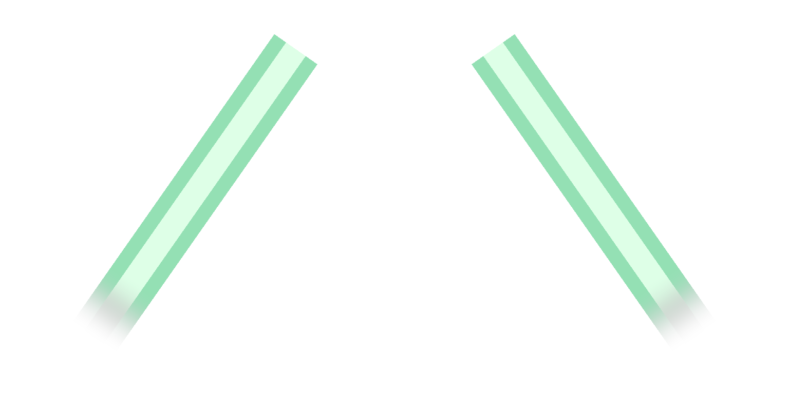
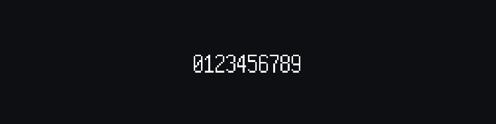

# Enemy23 연사·공중 표시·레이저와 데미지 숫자 폰트

작업일: 2026-11-24.

이후 강화탄 생성점 통일과 정지 사격 호버링 조정은 [Boss23SalvoHoverNotes.md](Boss23SalvoHoverNotes.md)를 따른다.

## 강화 연사

사용자 확인에 따라 기존 수평·위 12도·위 24도의 **3방향은 유지**하고, 강화에서만 발사 높이의 무작위 오프셋을 제거했다. 앞뒤 런처 교대와 실제 총구 위치, 거리 유지 이동·호버링도 유지한다. 따라서 총구를 기준으로 추가되는 무작위 높이는 0이며, 보스가 부유할 때 총구가 움직이는 것은 그대로다. 일반 연사는 기존 Vertical Spawn Offset 0.3유닛을 사용한다.

## 공중 전환의 23 표기와 경광등

변형 후반부의 본체는 비행 자세로 바뀌었는데, 표시 위치에는 지상 자세의 오프셋이 남아 있었다. Rise 후반 3프레임과 이에 대응하는 Descend 초반 3프레임의 위치를 비행 기본 자세에 맞췄다. 스프라이트·재생 시간은 변경하지 않았다.

11월 24일에는 Rise의 23 표기 Y를 원본 픽셀 단위로 **8.5 / 5.5 / 4.5 / 5.5 / 10.5 / 10.5**로 맞췄으나, 후반 비행 자세가 여전히 5px 낮았다. **11월 26일에 8.5 / 5.5 / 4.5 / 10.5 / 15.5 / 15.5px로 보정했다.** Descend는 역순이며 AirIdle·공중 사격도 15.5px다. 최신 결과와 비교 이미지는 [Boss23AirAudioNotes.md](Boss23AirAudioNotes.md)를 따른다.

경광등은 **원본 스프라이트 기준 2px** 위로 이동했다. 28PPU이므로 로컬 좌표 2/28유닛이며, 보스 크기 배율을 함께 따른다. 인스펙터 기본 위치만 바꾸면 애니메이션에 덮어써지므로, 20개 클립의 경광등 Y 트랙도 반영했다. 기존 숫자와 경광등의 세로 간격 8px가 10px로 바뀐다. 동일 도구를 다시 실행해도 높이가 누적되지 않도록 숫자 트랙을 기준으로 계산한다.

비교: [수정 전](Boss23AirAlignmentBefore.png), [수정 후](Boss23AirAlignmentAfter.png). 각 이미지의 위쪽은 Rise 6프레임 + AirIdle, 아래쪽은 Descend 6프레임 + Idle이다.

## 사선 레이저

기존 빔 메시와 텍스처 자체는 직사각형이었다. 다만 바닥 페이드가 각 픽셀의 월드 Y를 사용해, 기울어진 빔의 양쪽을 서로 다르게 투명하게 만들고 있었다.

이제 레이저 진행 방향으로 투영한 거리로 단면 중심의 높이를 구해 페이드한다. 같은 단면의 양쪽에 같은 알파를 적용하므로 폭이 일정하게 유지된다. 바닥 쪽 끝의 그라데이션, 회전·시간 페이드, 표시/피해 폭 설정은 유지한다. `FanLaser > Width`가 현재 0.8유닛이며 그대로 조절할 수 있다.

GPU 렌더링에서 ±35도 각각 폭 **0.8유닛**을 확인했다. 끝에서 0.2/0.4/0.7/1.2유닛 떨어진 같은 단면의 좌우 알파 차이는 최대 약 0.004였고, 끝으로 갈수록 사라지는 페이드도 유지됐다.

## 데미지 인디케이터 픽셀 폰트

기존 `Assets/_Graphics/Font/Amberjack/AmberjackPixel Raster.asset`를 참조한다. 폰트 파일·아틀라스 자체는 수정하지 않았다. 공용 `EnemyDamageIndicator.prefab`의 폰트와, 허용 영역의 `EnemyDamageIndicatorText.mat`를 해당 Bitmap 재질로 맞췄다. 기존 SDF 재질을 그대로 사용해 글자가 깨지는 것을 방지한다.

서체별 숫자 높이 차이를 보정하기 위해 글자 크기는 36 → **42**로 설정했다. 이전 서체의 실제 숫자 높이와 거의 같으며, 일반 흰색·크리티컬 노란색, 반올림, 크기·이동·페이드 연출은 유지한다. 조정 위치는 `Assets/_Prefabs/Enemies/Effects/EnemyDamageIndicator.prefab`의 TMP 텍스트다.

## 직접 테스트

1. `Assets/_Scenes/Test/EnemyTestScene.unity`에서 플레이어와 Enemy23을 켜고 실행한다.
2. 보스 HP를 35% 이하로 낮춰 강화 연사를 좌우에서 유도한다. 3방향은 유지하되 총구에서 ±0.3유닛 무작위로 튀어나오는 변동이 없어야 한다.
3. 공중 전환·복귀를 반복하며 변형 후반에 23과 경광등이 본체에서 어긋나지 않는지 본다. 경광등은 모션 전체에서 2px 높은 위치를 유지해야 한다.
4. 사선 레이저를 좌우로 회전시켜 빔 양옆이 평행하고, 끝부분은 폭을 비틀지 않으며 페이드되는지 확인한다.
5. 적을 공격해 픽셀 숫자를 확인한다. 9.8은 10으로 표시돼야 하고, 크리티컬 표시 테스트는 같은 폰트의 노란색이어야 한다.

## 검증

- 지상 8개·공중 7개 시나리오 통과. 강화 연사 36발의 추가 높이 오차는 좌우 모두 **0**, 일반 변동은 유지됐다.
- 20개 클립의 경광등 오프셋 확인, 변형 전후 이미지 비교.
- 사선 ±35도 GPU 단면·폭·그라데이션 검사 통과.
- 실제 팝업 생성에서 일반 9.8 → 10, 크리티컬 25.5 → 26, 공유 픽셀 폰트·흰색/노란색·수명 종료 후 정리 확인.
- 컴파일 오류 없이 실행했으며 씬 파일은 수정하지 않았다.

결과: [지상](Boss23VisualFixGroundVerification.json), [공중](Boss23VisualFixAirVerification.json), [레이저](Boss23StraightLaserVerification.json), [픽셀 팝업](DamageIndicatorPixelFontVerification.json).

## 사용 문법과 이유

- **조건 연산자 `?:`**: 강화에서는 높이 오프셋을 0으로, 일반에서는 기존 Random.Range로 선택한다.
- **AnimationCurve와 Constant 탄젠트**: 본체 스프라이트가 교체되는 프레임에 표시도 함께 이동하게 한다. 프레임 사이에서 표시만 미끄러지는 것을 방지한다.
- **내적 `dot`**: 픽셀을 빔 진행 방향의 거리로 투영한다. 같은 단면의 양쪽에서 동일한 페이드 기준을 얻는다.
- **TMP_FontAsset·공유 Material 참조**: 기존 픽셀 아틀라스를 재사용하고, 여러 팝업이 같은 폰트와 재질을 사용한다.

연결 도구: `SetupBoss23VisualFix.Run`. 확인 도구: `InspectBoss23VisualFix.Before/After`, `VerifyEnemyVisualFix.CheckAssets/Laser/FontPreview/Popups`, `VerifyBoss23Rework.RunGround/RunAir`.
