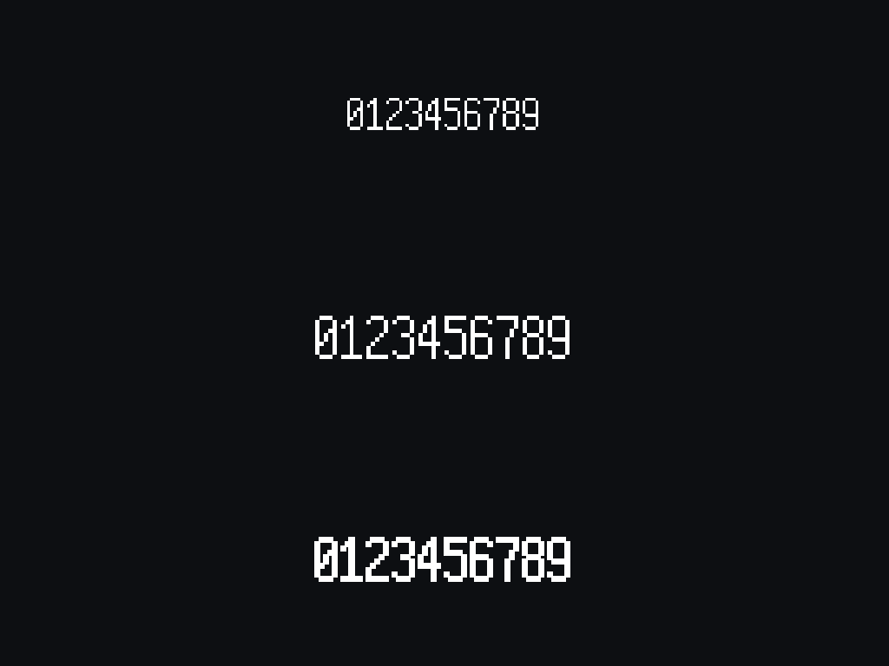

# 데미지 숫자 크기·굵기 개선

작업일: 2026-11-24.

기존 AmberjackPixel Raster 폰트를 유지하면서 글자 크기를 **42 → 56**으로 약 33% 키웠다. 폰트 파일·아틀라스는 수정하지 않았다. 일반·크리티컬의 크기 배율과 튕김·이동·수명은 그대로 사용하므로 양쪽 모두 커지며 크리티컬은 여전히 더 크게 표시된다.

Bitmap 기본 재질은 획 두께를 지원하지 않으므로, 허용된 셰이더 영역에 `Enemy/DamageIndicatorBitmap`을 추가했다. 같은 폰트 아틀라스를 공유하고 이웃 픽셀의 알파로 획을 **0.25 아틀라스 픽셀** 보강한다. 0.5는 숫자 사이와 내부 공간이 과하게 메워져 0.25로 낮췄다. 색상·CanvasGroup 페이드·UI 마스크 처리는 유지한다. 팝업마다 추가 텍스트 오브젝트나 재질을 만들지 않는다.

## 조절 위치

| 항목 | 위치 | 현재 값 |
| --- | --- | --- |
| 기본 크기 | `Assets/_Prefabs/Enemies/Effects/EnemyDamageIndicator.prefab`의 TMP 텍스트 / Font Size | **56** |
| 획 보강 | `Assets/_Graphics/Materials/Enemy/EnemyDamageIndicatorText.mat` / Stroke Expansion (Atlas Pixels) | **0.25** |

Stroke Expansion을 0으로 하면 원래 얇은 획으로 돌아간다. 이 값은 화면 픽셀이 아니라 폰트 아틀라스의 픽셀 기준이다.

## 비교와 검증

아래 이미지는 위부터 **기존 42·보강 없음 / 56·보강 없음 / 현재 56·0.25 보강**이다.

같은 크기 56에서 획이 차지하는 밝은 픽셀은 4,835 → 7,365로 약 52% 늘었다. 이는 고정된 비교 카메라의 결과이며 화면 전체의 가시성을 수치화한 점수는 아니다. 0·6·8·9의 내부 공간이 남는지도 이미지를 직접 확인했다.

EnemyTestScene Play Mode에서 일반·크리티컬 팝업이 크기 56과 같은 획 보강 재질을 사용하는지 확인했다. 9.8 → 10, 25.5 → 26 반올림, 흰색/노란색, 폴백 폰트 미사용과 수명 종료 후 정리도 통과했다. 셰이더 오류 없이 확인했고 씬 파일은 수정하지 않았다.

결과: [렌더 비교](DamageIndicatorReadabilityRenderVerification.json), [실행 검증](DamageIndicatorReadabilityRuntimeVerification.json).

## 직접 테스트

1. `Assets/_Scenes/Test/EnemyTestScene.unity`를 열고 플레이어와 적을 활성화해 실행한다.
2. 적을 연속으로 공격한다. 숫자가 전보다 크고 두껍게 나오며 튕긴 뒤 상승·페이드되어야 한다.
3. 실제 게임 카메라에서 가장 작은 일반 숫자도 읽히는지 확인한다. 크리티컬 표시를 호출하면 노란색과 기존의 큰 크기 배율이 유지돼야 한다.
4. 필요하면 위 두 설정을 조정한다. 두께를 크게 올릴 때는 0·8·9의 내부 공간과 숫자 사이 간격을 함께 확인한다.

## 사용 문법과 이유

- **`_MainTex_TexelSize`**: 폰트 텍스처의 한 픽셀 크기를 UV 간격으로 사용한다. 임의 해상도의 화면 픽셀에 굵기를 고정하지 않는다.
- **`max`와 주변 알파 샘플**: 주변 8방향의 획을 조금 확장해 같은 픽셀 폰트의 두께를 늘린다.
- **공유 Material**: 모든 인디케이터가 같은 설정을 사용해 일반·크리티컬 굵기가 따로 어긋나지 않게 한다.

적용 도구는 `TuneDamageIndicatorReadability.Run`, 비교 이미지는 `.Compare`, 실행 검증은 `VerifyEnemyVisualFix.Popups`다.
